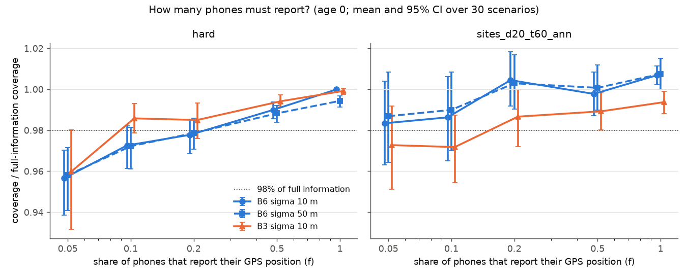
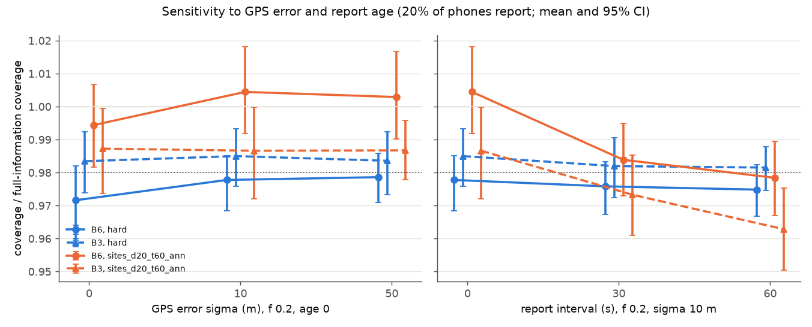
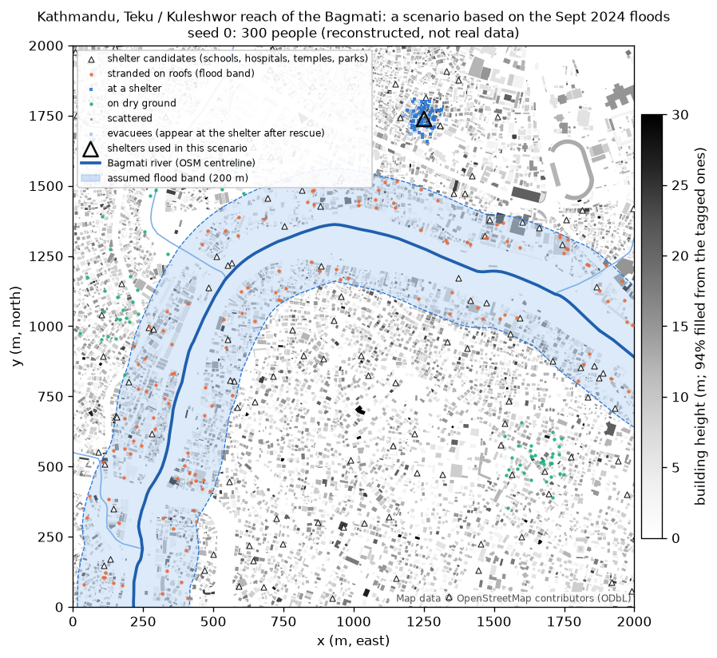
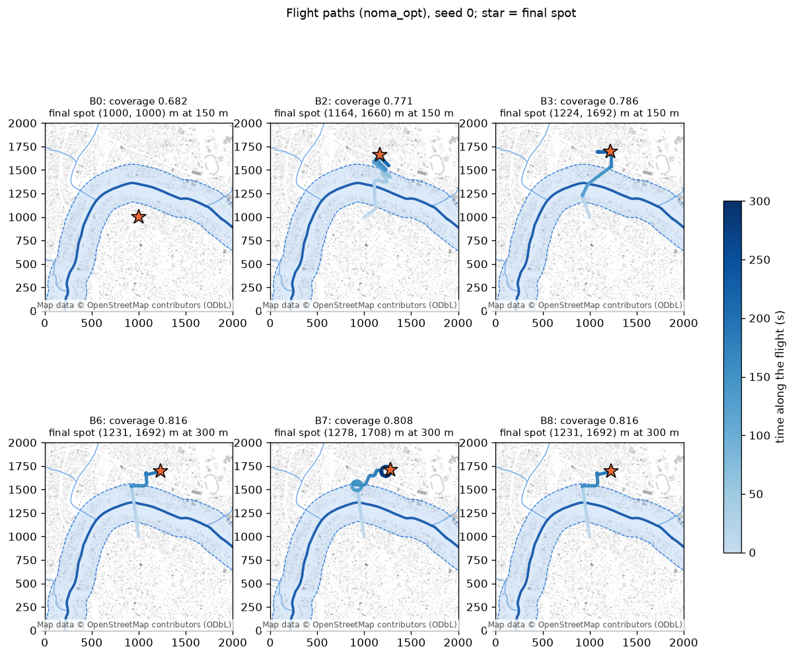
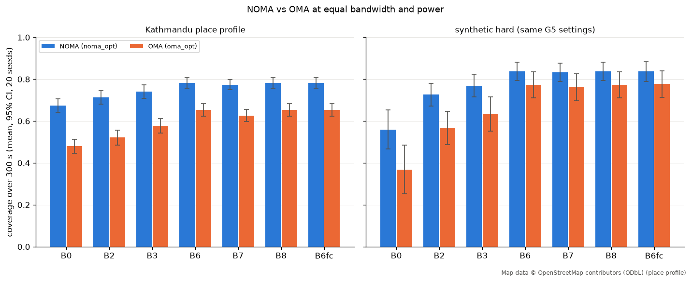

# Chapter 7. Baselines and their results

## 7.1 The simple pilots
**Plain words.** Before trusting an AI pilot we need strong rivals that do not learn: if the AI only beats "a drone that does
nothing", it proves nothing. Each rival plays exactly the same game (`env.step()`), on exactly the same scenarios.

| ID | Name | What it does | Settings |
|---|---|---|---|
| B0 | Fixed | sits at the map centre at 150 m and full power, forever | |
| B1 | Follow the crowd | every second, flies toward the centre of the biggest true cluster | uses true cluster ids |
| B2 | Weighted k-means | every 10 s, clusters the users (k = 3, rescue users count 3x) and flies to the heaviest cluster centre | uses true positions |
| B3 | Grid search | every 10 s, scores a grid of candidate spots (10 x 10, or 14 x 14 on 2 km maps) plus the current spot at 150 m and flies to the best | uses `env.evaluate` |
| B4 | Particle swarm (PSO) | every 10 s, searches position, altitude and power with 12 particles x 10 iterations; objective = the v2 reward | |
| B5 | Energy-aware | like B3, but moves only if the coverage gain x 10 s exceeds the extra energy cost of moving; that cost is clamped at 0 because forward flight is cheaper than hovering, so B5 behaves like B3 (D-14) | |
| B6 | Grid search + altitude | like B3, but tries 5 altitudes (50, 100, 150, 200, 300 m) at every grid spot | added 10-19 (D-16) |
| B7 | Circling pilot | chooses spots like B6, but circles them (radius 50 m) at the speed that uses the least power (9.8 m/s) instead of hovering | added 10-21 (D-45, 7.10) |
| B8 | Battery rule | flies like B6, circles instead of hovering once the battery would not last | added 10-22 (D-52, 7.12) |
| B3obs, B3obsU, B3obsUO | Information ladder | B3's search with only the AI's capped maps / uncapped maps / plus buildings; diagnostic only, not in the default runs | added 10-21 (D-37, Chapter 8.7) |

The baselines see the true user positions (privileged information); the AI only sees maps. That makes them a strong test.
Code: `uav_dataset/baselines.py`; settings in `config.yaml` (`baselines:`).

## 7.2 How results are measured
- **coverage_full**: the share of users served, averaged over the whole 300 s, counting 0 after the battery dies (the main metric).
- **coverage_alive**: the same, only over the seconds the drone was flying.
- **survived the horizon**: share of scenarios where the battery lasted 300 s.
- **served-user-seconds per Wh**, **rescue outage** (share of rescue users not served), **fairness** (Jain's index).
- Every value is **mean +/- 95% confidence interval** over scenarios (`evalstats.mean_ci`, 1.96 standard errors).
- **Paired differences** (`evalstats.paired_diff`): for every scenario, pilot A's score minus pilot B's; then mean and CI of those
  differences. Fairer than comparing two averages because it cancels "that scenario was easy for everyone". A `*` means the CI
  excludes 0, so the difference is not luck (a tiny `+0.000*` is not a real gap).

Reproduce: `cd uav_dataset && python run_baselines.py [--profile <name>] [--battery_wh <Wh>] [--seeds N]` (results go to
`uav_dataset/results/`, not committed; the tables below are copies).

## 7.3 What the results say (summary)
1. **Default scenarios, 10 Wh:** no pilot survives 300 s (hovering needs 14.7 Wh), so the ranking mostly measures survival time.
   B4 has the best coverage while alive (0.913) but ties B0 overall because it dies first.
2. **Moving costs less than hovering** in this energy model (134 vs 176 J/s), so pilots that move last longer.
3. **Default scenarios, 16 Wh (everyone survives):** B4 0.914, B3 0.909, B5 0.908, B2 0.887, B1 0.884, B0 0.882. A parked drone
   already covers 88%: very little headroom. B1 and B2 do not significantly beat B0.
4. **`hard` profile:** the parked drone falls to 0.428 and the best pilots reach 0.740: a 31-point gap. **H1 holds here.**
   Neither low power alone nor a big map alone produces it; the combination does.
5. **B6 ties B4** (0.741 vs 0.740): B4's lead over B3 was choosing a better altitude, not better placement. The bar for the AI on
   `hard` is about 0.74.
6. **On the still-crowd test used for RL (`rl_static`, validation seeds):** Random 0.413, B0 0.441, B1 0.600, B2 0.610,
   B3 = B5 0.659; the best single spot reached instantly would give 0.686.
7. Caveats: baseline settings are untuned engineering choices; minimum rates are unsigned assumptions; one-step-greedy searches
   (B3, B4, B6) cannot anticipate where a crowd is going.

Bar charts: [default 10 Wh](figures/baselines_default_10wh.png), [default 16 Wh](figures/baselines_default_16wh.png),
[hard, 7 pilots](figures/baselines_hard_7policies.png). Example flights: [hard scenario 5](figures/1_hard_moving_crowds.png),
[surge custom scenario](figures/3_surge_custom.png).

## 7.4 Default scenarios, 10 Wh (100 scenarios, seeds 0-99)

Battery: 10 Wh, horizon 300 s.

Scenarios per policy: 100. Values are mean +/- 95% CI over scenarios.

| Policy | coverage_full | coverage_alive | survived the horizon | served-user-s per Wh | rescue outage | fairness |
|---|---|---|---|---|---|---|
| B0 | 0.602 +/- 0.006 | 0.880 +/- 0.009 | 0% | 10052.6 +/- 1208.2 | 0.073 +/- 0.024 | 0.729 +/- 0.008 |
| B1 | 0.619 +/- 0.005 | 0.882 +/- 0.007 | 0% | 10362.0 +/- 1249.4 | 0.101 +/- 0.025 | 0.689 +/- 0.006 |
| B2 | 0.650 +/- 0.006 | 0.886 +/- 0.006 | 0% | 10860.6 +/- 1310.1 | 0.089 +/- 0.021 | 0.694 +/- 0.005 |
| B3 | 0.651 +/- 0.004 | 0.908 +/- 0.005 | 0% | 10880.0 +/- 1302.9 | 0.040 +/- 0.013 | 0.726 +/- 0.005 |
| B4 | 0.601 +/- 0.004 | 0.913 +/- 0.004 | 0% | 10092.4 +/- 1213.9 | 0.021 +/- 0.005 | 0.778 +/- 0.005 |
| B5 | 0.653 +/- 0.005 | 0.907 +/- 0.005 | 0% | 10901.3 +/- 1302.3 | 0.039 +/- 0.013 | 0.727 +/- 0.005 |

Paired difference in coverage_full (row minus column; positive = row is better; * = the 95% CI excludes 0):

| | B0 | B1 | B2 | B3 | B4 | B5 |
|---|---|---|---|---|---|---|
| B0 | - | -0.017* | -0.048* | -0.049* | +0.000 | -0.052* |
| B1 | +0.017* | - | -0.031* | -0.032* | +0.017* | -0.035* |
| B2 | +0.048* | +0.031* | - | -0.001 | +0.049* | -0.003 |
| B3 | +0.049* | +0.032* | +0.001 | - | +0.050* | -0.002* |
| B4 | -0.000 | -0.017* | -0.049* | -0.050* | - | -0.052* |
| B5 | +0.052* | +0.035* | +0.003 | +0.002* | +0.052* | - |

Mean coverage_full by mobility model (scenario counts: group_drift 23, surge 22, hotspot_jump 21, random_waypoint 17, attraction 17):

| mobility        |    B0 |    B1 |    B2 |    B3 |    B4 |    B5 |
|:----------------|------:|------:|------:|------:|------:|------:|
| attraction      | 0.605 | 0.623 | 0.656 | 0.656 | 0.609 | 0.664 |
| group_drift     | 0.589 | 0.604 | 0.639 | 0.647 | 0.601 | 0.647 |
| hotspot_jump    | 0.608 | 0.62  | 0.645 | 0.648 | 0.597 | 0.649 |
| random_waypoint | 0.606 | 0.616 | 0.657 | 0.657 | 0.598 | 0.658 |
| surge           | 0.603 | 0.63  | 0.656 | 0.65  | 0.603 | 0.652 |

## 7.5 Default scenarios, 16 Wh (100 scenarios)

Battery: 16 Wh, horizon 300 s.

Scenarios per policy: 100. Values are mean +/- 95% CI over scenarios.

| Policy | coverage_full | coverage_alive | survived the horizon | served-user-s per Wh | rescue outage | fairness |
|---|---|---|---|---|---|---|
| B0 | 0.882 +/- 0.008 | 0.882 +/- 0.008 | 100% | 10068.6 +/- 1209.4 | 0.069 +/- 0.023 | 0.731 +/- 0.008 |
| B1 | 0.884 +/- 0.007 | 0.884 +/- 0.007 | 100% | 10343.3 +/- 1248.1 | 0.098 +/- 0.025 | 0.689 +/- 0.006 |
| B2 | 0.887 +/- 0.006 | 0.887 +/- 0.006 | 100% | 10850.0 +/- 1306.9 | 0.088 +/- 0.021 | 0.694 +/- 0.004 |
| B3 | 0.909 +/- 0.005 | 0.909 +/- 0.005 | 100% | 10907.3 +/- 1308.6 | 0.037 +/- 0.011 | 0.726 +/- 0.004 |
| B4 | 0.914 +/- 0.004 | 0.914 +/- 0.004 | 100% | 10308.0 +/- 1241.1 | 0.018 +/- 0.004 | 0.783 +/- 0.005 |
| B5 | 0.908 +/- 0.005 | 0.908 +/- 0.005 | 100% | 10924.7 +/- 1308.0 | 0.037 +/- 0.011 | 0.727 +/- 0.004 |

Paired difference in coverage_full (row minus column; positive = row is better; * = the 95% CI excludes 0):

| | B0 | B1 | B2 | B3 | B4 | B5 |
|---|---|---|---|---|---|---|
| B0 | - | -0.002 | -0.005 | -0.027* | -0.033* | -0.027* |
| B1 | +0.002 | - | -0.003* | -0.025* | -0.031* | -0.025* |
| B2 | +0.005 | +0.003* | - | -0.022* | -0.028* | -0.022* |
| B3 | +0.027* | +0.025* | +0.022* | - | -0.006* | +0.000* |
| B4 | +0.033* | +0.031* | +0.028* | +0.006* | - | +0.006* |
| B5 | +0.027* | +0.025* | +0.022* | -0.000* | -0.006* | - |

Mean coverage_full by mobility model (scenario counts: group_drift 23, surge 22, hotspot_jump 21, random_waypoint 17, attraction 17):

| mobility        |    B0 |    B1 |    B2 |    B3 |    B4 |    B5 |
|:----------------|------:|------:|------:|------:|------:|------:|
| attraction      | 0.885 | 0.892 | 0.893 | 0.917 | 0.919 | 0.917 |
| group_drift     | 0.866 | 0.866 | 0.874 | 0.9   | 0.911 | 0.9   |
| hotspot_jump    | 0.889 | 0.88  | 0.884 | 0.905 | 0.911 | 0.905 |
| random_waypoint | 0.89  | 0.888 | 0.887 | 0.909 | 0.915 | 0.909 |
| surge           | 0.882 | 0.895 | 0.897 | 0.914 | 0.918 | 0.914 |

## 7.6 Profile `lowpower` (50 scenarios, 10 Wh)

Profile: lowpower. Area 1000 m, max power 20 dBm, battery 10 Wh, horizon 300 s.

Scenarios per policy: 50. Values are mean +/- 95% CI over scenarios.

| Policy | coverage_full | coverage_alive | survived the horizon | served-user-s per Wh | rescue outage | fairness |
|---|---|---|---|---|---|---|
| B0 | 0.552 +/- 0.023 | 0.796 +/- 0.032 | 0% | 8699.8 +/- 1464.1 | 0.354 +/- 0.079 | 0.746 +/- 0.017 |
| B1 | 0.581 +/- 0.017 | 0.817 +/- 0.023 | 0% | 9403.9 +/- 1612.2 | 0.313 +/- 0.049 | 0.690 +/- 0.018 |
| B2 | 0.617 +/- 0.018 | 0.826 +/- 0.022 | 0% | 9948.8 +/- 1701.0 | 0.298 +/- 0.048 | 0.704 +/- 0.014 |
| B3 | 0.616 +/- 0.014 | 0.859 +/- 0.019 | 0% | 9986.7 +/- 1694.2 | 0.221 +/- 0.048 | 0.742 +/- 0.012 |
| B4 | 0.582 +/- 0.010 | 0.880 +/- 0.015 | 0% | 9548.8 +/- 1633.6 | 0.125 +/- 0.038 | 0.818 +/- 0.011 |
| B5 | 0.617 +/- 0.014 | 0.859 +/- 0.019 | 0% | 9990.6 +/- 1694.4 | 0.221 +/- 0.048 | 0.742 +/- 0.012 |

Paired difference in coverage_full (row minus column; positive = row is better; * = the 95% CI excludes 0):

| | B0 | B1 | B2 | B3 | B4 | B5 |
|---|---|---|---|---|---|---|
| B0 | - | -0.030* | -0.065* | -0.065* | -0.031* | -0.065* |
| B1 | +0.030* | - | -0.036* | -0.035* | -0.001 | -0.035* |
| B2 | +0.065* | +0.036* | - | +0.000 | +0.035* | +0.000 |
| B3 | +0.065* | +0.035* | -0.000 | - | +0.034* | -0.000 |
| B4 | +0.031* | +0.001 | -0.035* | -0.034* | - | -0.034* |
| B5 | +0.065* | +0.035* | -0.000 | +0.000 | +0.034* | - |

Mean coverage_full by mobility model (scenario counts: group_drift 14, hotspot_jump 11, random_waypoint 10, surge 8, attraction 7):

| mobility | B0 | B1 | B2 | B3 | B4 | B5 |
|---|---|---|---|---|---|---|
| attraction | 0.556 | 0.597 | 0.639 | 0.634 | 0.590 | 0.636 |
| group_drift | 0.531 | 0.532 | 0.582 | 0.585 | 0.563 | 0.585 |
| hotspot_jump | 0.571 | 0.607 | 0.626 | 0.629 | 0.592 | 0.629 |
| random_waypoint | 0.578 | 0.590 | 0.623 | 0.626 | 0.587 | 0.625 |
| surge | 0.525 | 0.607 | 0.638 | 0.626 | 0.589 | 0.626 |

## 7.7 Profile `bigarea` (50 scenarios, 10 Wh)

Profile: bigarea. Area 2000 m, max power 30 dBm, battery 10 Wh, horizon 300 s.

Scenarios per policy: 50. Values are mean +/- 95% CI over scenarios.

| Policy | coverage_full | coverage_alive | survived the horizon | served-user-s per Wh | rescue outage | fairness |
|---|---|---|---|---|---|---|
| B0 | 0.522 +/- 0.018 | 0.765 +/- 0.027 | 0% | 8298.9 +/- 1384.0 | 0.497 +/- 0.099 | 0.730 +/- 0.031 |
| B1 | 0.582 +/- 0.016 | 0.812 +/- 0.022 | 0% | 9420.7 +/- 1610.3 | 0.375 +/- 0.057 | 0.622 +/- 0.017 |
| B2 | 0.627 +/- 0.017 | 0.821 +/- 0.021 | 0% | 10135.2 +/- 1732.4 | 0.357 +/- 0.055 | 0.649 +/- 0.014 |
| B3 | 0.603 +/- 0.014 | 0.845 +/- 0.019 | 0% | 9786.4 +/- 1665.5 | 0.306 +/- 0.060 | 0.675 +/- 0.017 |
| B4 | 0.589 +/- 0.010 | 0.876 +/- 0.013 | 0% | 9639.5 +/- 1647.1 | 0.209 +/- 0.046 | 0.746 +/- 0.013 |
| B5 | 0.604 +/- 0.014 | 0.844 +/- 0.019 | 0% | 9788.0 +/- 1665.7 | 0.307 +/- 0.060 | 0.675 +/- 0.017 |

Paired difference in coverage_full (row minus column; positive = row is better; * = the 95% CI excludes 0):

| | B0 | B1 | B2 | B3 | B4 | B5 |
|---|---|---|---|---|---|---|
| B0 | - | -0.060* | -0.104* | -0.081* | -0.066* | -0.081* |
| B1 | +0.060* | - | -0.044* | -0.021* | -0.006 | -0.021* |
| B2 | +0.104* | +0.044* | - | +0.023* | +0.038* | +0.023* |
| B3 | +0.081* | +0.021* | -0.023* | - | +0.015* | -0.000 |
| B4 | +0.066* | +0.006 | -0.038* | -0.015* | - | -0.015* |
| B5 | +0.081* | +0.021* | -0.023* | +0.000 | +0.015* | - |

Mean coverage_full by mobility model (scenario counts: group_drift 14, hotspot_jump 11, random_waypoint 10, surge 8, attraction 7):

| mobility | B0 | B1 | B2 | B3 | B4 | B5 |
|---|---|---|---|---|---|---|
| attraction | 0.527 | 0.599 | 0.645 | 0.615 | 0.600 | 0.613 |
| group_drift | 0.493 | 0.541 | 0.598 | 0.567 | 0.568 | 0.567 |
| hotspot_jump | 0.529 | 0.610 | 0.641 | 0.625 | 0.598 | 0.625 |
| random_waypoint | 0.532 | 0.582 | 0.613 | 0.616 | 0.599 | 0.616 |
| surge | 0.549 | 0.602 | 0.658 | 0.612 | 0.589 | 0.615 |

## 7.8 Profile `hard`, all 7 pilots (100 scenarios, 16 Wh)

Profile: hard. Area 2000 m, max power 20 dBm, battery 16 Wh, horizon 300 s.

Scenarios per policy: 100. Values are mean +/- 95% CI over scenarios.

| Policy | coverage_full | coverage_alive | survived the horizon | served-user-s per Wh | rescue outage | fairness |
|---|---|---|---|---|---|---|
| B0 | 0.428 +/- 0.042 | 0.428 +/- 0.042 | 100% | 4207.4 +/- 664.6 | 0.846 +/- 0.034 | 0.504 +/- 0.041 |
| B1 | 0.627 +/- 0.027 | 0.627 +/- 0.027 | 100% | 7157.9 +/- 870.4 | 0.535 +/- 0.031 | 0.538 +/- 0.021 |
| B2 | 0.633 +/- 0.027 | 0.633 +/- 0.027 | 100% | 7575.5 +/- 901.2 | 0.524 +/- 0.031 | 0.562 +/- 0.019 |
| B3 | 0.675 +/- 0.025 | 0.675 +/- 0.025 | 100% | 7680.0 +/- 901.9 | 0.506 +/- 0.029 | 0.592 +/- 0.018 |
| B4 | 0.740 +/- 0.023 | 0.740 +/- 0.023 | 100% | 8079.1 +/- 936.5 | 0.417 +/- 0.036 | 0.709 +/- 0.017 |
| B5 | 0.675 +/- 0.025 | 0.675 +/- 0.025 | 100% | 7680.6 +/- 903.0 | 0.505 +/- 0.029 | 0.593 +/- 0.018 |
| B6 | 0.741 +/- 0.023 | 0.741 +/- 0.023 | 100% | 8004.4 +/- 926.0 | 0.419 +/- 0.038 | 0.715 +/- 0.017 |

Paired difference in coverage_full (row minus column; positive = row is better; * = the 95% CI excludes 0):

| | B0 | B1 | B2 | B3 | B4 | B5 | B6 |
|---|---|---|---|---|---|---|---|
| B0 | - | -0.199* | -0.205* | -0.247* | -0.312* | -0.247* | -0.313* |
| B1 | +0.199* | - | -0.006 | -0.048* | -0.114* | -0.048* | -0.114* |
| B2 | +0.205* | +0.006 | - | -0.042* | -0.108* | -0.042* | -0.108* |
| B3 | +0.247* | +0.048* | +0.042* | - | -0.065* | +0.000 | -0.066* |
| B4 | +0.312* | +0.114* | +0.108* | +0.065* | - | +0.066* | -0.000 |
| B5 | +0.247* | +0.048* | +0.042* | -0.000 | -0.066* | - | -0.066* |
| B6 | +0.313* | +0.114* | +0.108* | +0.066* | +0.000 | +0.066* | - |

Mean coverage_full by mobility model (scenario counts: attraction 27, surge 25, group_drift 25, hotspot_jump 23):

| mobility | B0 | B1 | B2 | B3 | B4 | B5 | B6 |
|---|---|---|---|---|---|---|---|
| attraction | 0.482 | 0.665 | 0.664 | 0.700 | 0.770 | 0.700 | 0.769 |
| group_drift | 0.419 | 0.646 | 0.652 | 0.701 | 0.760 | 0.701 | 0.757 |
| hotspot_jump | 0.376 | 0.575 | 0.577 | 0.625 | 0.699 | 0.624 | 0.700 |
| surge | 0.427 | 0.615 | 0.630 | 0.667 | 0.727 | 0.667 | 0.730 |

## 7.9 Still crowd `rl_static`, validation seeds 100-119 (reference for the AI)

Split: val (20 scenarios, seeds 100-119). Profile: rl_static. Controls: xy. Area 2000 m, 20 dBm, battery 16 Wh.

Scenarios per policy: 20. Values are mean +/- 95% CI over scenarios.

| Policy | coverage_full | coverage_alive | survived the horizon | served-user-s per Wh | rescue outage | fairness |
|---|---|---|---|---|---|---|
| B0 | 0.441 +/- 0.101 | 0.441 +/- 0.101 | 100% | 2717.5 +/- 881.6 | 0.865 +/- 0.071 | 0.489 +/- 0.100 |
| B1 | 0.600 +/- 0.076 | 0.600 +/- 0.076 | 100% | 4190.8 +/- 1121.8 | 0.584 +/- 0.093 | 0.494 +/- 0.058 |
| B2 | 0.610 +/- 0.068 | 0.610 +/- 0.068 | 100% | 4484.4 +/- 1128.2 | 0.526 +/- 0.086 | 0.529 +/- 0.043 |
| B3 | 0.659 +/- 0.069 | 0.659 +/- 0.069 | 100% | 4576.6 +/- 1156.6 | 0.542 +/- 0.102 | 0.557 +/- 0.043 |
| B5 | 0.659 +/- 0.069 | 0.659 +/- 0.069 | 100% | 4576.6 +/- 1156.6 | 0.542 +/- 0.102 | 0.557 +/- 0.043 |
| Random | 0.413 +/- 0.091 | 0.413 +/- 0.091 | 100% | 3193.6 +/- 932.4 | 0.870 +/- 0.056 | 0.459 +/- 0.095 |

Paired difference in coverage_full (row minus column; positive = row is better; * = the 95% CI excludes 0):

| | B0 | B1 | B2 | B3 | B5 | Random |
|---|---|---|---|---|---|---|
| B0 | - | -0.158* | -0.169* | -0.218* | -0.218* | +0.028 |
| B1 | +0.158* | - | -0.011 | -0.060* | -0.060* | +0.186* |
| B2 | +0.169* | +0.011 | - | -0.049* | -0.049* | +0.197* |
| B3 | +0.218* | +0.060* | +0.049* | - | +0.000 | +0.246* |
| B5 | +0.218* | +0.060* | +0.049* | +0.000 | - | +0.246* |
| Random | -0.028 | -0.186* | -0.197* | -0.246* | -0.246* | - |

Mean coverage_full by mobility model (scenario counts: static 20):

| mobility | B0 | B1 | B2 | B3 | B5 | Random |
|---|---|---|---|---|---|---|
| static | 0.441 | 0.600 | 0.610 | 0.659 | 0.659 | 0.413 |

## 7.10 The circling pilot B7: does circling save battery? (plan step 5, 2026-10-21)
**Plain words.** In the energy model of Zeng, Xu and Zhang, a drone flying at about 10 m/s uses less power than one hovering
(126 W against 168 W), as with helicopters, which get extra lift from forward flight. So instead of parking over the best spot,
B7 flies a 50 m circle around it. It chooses its spots exactly like B6. All runs with the acceleration limit and the turning
cost switched on, so the comparison cannot be won by the shaking trick.

**Main test (D-45): fly until the battery is empty.** Still crowds (`rl_static`), 10 Wh, up to 600 s, 50 scenarios:

| Pilot | People-seconds served | Flight time | Coverage while flying | Mean power |
|---|---|---|---|---|
| B6 (hovers) | 67,682 | 198 s | 0.697 | 182.5 W |
| **B7, circle 50 m** | **85,033 (+25.6%*)** | **249 s** | 0.696 (same) | 144.9 W |
| B7, circle 100 m | 83,725 (+23.7%*) | 251 s | 0.680 | 143.7 W |

Circling serves **about 26% more people per battery** with the same coverage while flying. Simple arithmetic predicts +31%
(power ratio 173.7 / 132.7 W); the measured gain is a little lower because both pilots pay the same fixed cost of flying to
their spot. A 50 m circle beats a 100 m circle (the wider circle strays further from the best spot).

**In the normal 5-minute mission** (`hard`, moving crowds, 100 scenarios):

| Battery | B6 (hovers) | B7 (circles) | Difference |
|---|---|---|---|
| 12 Wh | 0.596 (never survives) | **0.716** | +0.120* |
| 13 Wh | 0.652 (never survives) | **0.730** (survives 98%) | +0.079* |
| 14 Wh | 0.707 (survives 3%) | **0.731** | +0.024* |
| 16 Wh | **0.739** | 0.731 | -0.009* |

When the battery cannot cover hovering for the whole mission, circling wins clearly; when there is plenty of battery,
hovering is slightly better (circling keeps the drone up to 50 m from the best spot).

**Robustness (30 scenarios, one parameter changed at a time):** the gain stays between +21% and +31%: drag d0 0.3 (the paper's
value) +30.7%, induced power Pi +-20% +30.4% / +20.8%, acceleration limit 2 or 8 m/s^2 +24.9% / +26.2%, radius 100 m +24.4%.
So the conclusion does not depend on the unverified d0 = 0.6.

**Not verified.** The turning-energy term is our own quasi-steady extension; whether Zeng's forward-flight formula holds in
tight, slow circles is not verified (in this model even a 10 m circle is cheaper than hovering). Vertical acceleration is not
charged. Runs used today's NOMA, no fading, full power.

**Reproduce:** `python accel_loiter_exp.py run b` (also `a`, `c`, `d`), then `python accel_loiter_exp.py report`.

## 7.11 How much could an AI that anticipates gain? The clairvoyant pilot (plan step 3, 2026-10-21)
**Plain words.** H2 says an AI should beat the search pilots on moving crowds because it can *anticipate*: B6 only reacts to
where people are now. Before spending two weeks training, we measured the prize. A "clairvoyant" pilot that is **told the
crowd's entire future** plans the best possible flight (dynamic programming over every reachable spot, every 10 s, on B6's own
grid of 980 spots), and its plan is flown in the real game. No AI can do better than this pilot, so its lead over B6 is the most
an anticipating AI could ever gain. Pass mark fixed beforehand (D-51): at least 0.02 for some crowd type.

**Result (`hard`, 16 Wh, 120 scenarios, today's NOMA; paired with B6):**

| Crowd type | B6 | Clairvoyant (dp) | Gain | Teleport bound (ignores flight time) |
|---|---|---|---|---|
| attraction (32) | 0.776 | 0.778 | +0.001 | +0.015 |
| group drift (29) | 0.745 | 0.747 | +0.002 | +0.024 |
| hotspot jump (26) | 0.701 | 0.702 | +0.001 | +0.021 |
| surge (33) | 0.748 | 0.750 | +0.003 | +0.024 |
| all (120) | 0.745 | 0.746 | +0.002* | +0.021 |

**Knowing the whole future is worth +0.002 coverage: far below the 0.02 pass mark, for every crowd type.** The same holds with
adaptive NOMA (30 scenarios, +0.001) and, as expected, on still crowds (+0.000).

**Why.** B6 re-plans every 10 s and flies at 15 m/s, while crowds move at 0.5-3 m/s and the drone's coverage footprint is
hundreds of metres wide, so a greedy pilot simply keeps up. Even during surges and jumps (60-180 s) a teleporting drone would
add only +0.002. The only real gap is in the first minute (teleport bound +0.093): the unavoidable flight from the centre of the
map to the crowd, which no amount of foresight can shorten (dp +0.004 there).

**Side finding.** A pilot that looks only 30 s ahead does *worse* than B6 (-0.011, significant): it will not start a trip whose
payoff comes later. Half-way anticipation can lose to plain greedy re-planning.

**What it means for H2 (decision D-51).** In these scenarios there is no room for anticipation, so an AI cannot beat B6 by
anticipating, however well it learns. This is a result in itself ("greedy re-planning is near-optimal when the drone is much
faster than the crowd"). Not tested here: tight batteries (16 Wh never binds), where *when to move and how to spend the battery*
matters, and where B7 already showed gains of +0.08 to +0.12. Before G5 the scenarios must be redesigned so that decisions now
have consequences later, and the clairvoyant test re-run on them.

**How it was checked.** 22 tests (the coverage table equals the game's evaluation; the planner's first decision equals B6's;
every planned move is flyable; the planner equals brute force on a small grid; the bound is never below the planner; replays are
deterministic). I recomputed the gains from the raw episode file and re-ran B6 on one scenario: identical (0.7206), and B6's mean
on seeds 0-99 equals the G3 table (0.741). **Not verified:** a finer grid (that would be placement, not anticipation); the
planner is optimal for its model of the game, whose score is 0.005 above the replay.

**Reproduce:** `python oracle.py` (see its `--help`; coverage tables are cached in `results/oracle_cache/`).

## 7.12 Competing sites: where an AI that thinks ahead could win (D-52, phases 1-2, 2026-10-22)
**Plain words.** Step 3 showed that walking crowds leave no room for an AI: the drone easily keeps up. So we built new
scenarios, pre-registered before any run (D-52): survivors at two or three **sites 1.0-2.0 km apart**, and at some moment
between 60 and 150 s **half or more of the people who need the drone switch from site A to site B** (a shelter opens at B
and people are taken there; equivalently a tower is repaired at A and survivors are found at B), either at once or spread
over 1 or 3 minutes. A drone that sees it coming can start flying to B early; a pilot that only reacts arrives 1-2 minutes
late. All runs use the owner's G5 settings (adaptive NOMA, imperfect SIC 0.05, rescue users first, acceleration limit 4 m/s^2).

**How it is built.** An `active[t, user]` mask: users who switch off leave the "people to serve" count and get no radio
resources; equally many users at B switch on, so the crowd size, the class mix and the bandwidth stay the same. New profiles
`sites_d{10,15,20}_t{0,60,180}` only; with no mask the game is bit-for-bit the old one (tests for all four radio schemes and
a whole B6 mission; the old control run still gives 0.7206). 26 new tests.

**Phase 1: is a tight battery alone enough? No.** A one-line rule, **B8** (fly like B6, but circle instead of hovering once
the battery would not last), captures the whole battery decision on `hard` (100 scenarios):

| Battery | B6 (hovers) | B7 (circles) | B8 (rule) |
|---|---|---|---|
| 12 Wh | 0.596 | 0.716 | **0.716** |
| 13 Wh | 0.652 | 0.730 | **0.733** |

So, as the reviewer predicted, there is nothing left for an AI to win from the battery alone.

**Phase 2: room for an AI in the competing-sites scenarios** (12 scenarios per design; a pilot told the future, replayed in
the real game, minus the best of B6, B7 and B8 in that same scenario; pass mark +0.02):

| Sites apart (flight time) | Sudden switch | Switch over 1 min | Switch over 3 min |
|---|---|---|---|
| 1.0 km (67 s) | **+0.025** ✓ | +0.009 | +0.005 |
| 1.5 km (100 s) | **+0.072** ✓ | **+0.039** ✓ | +0.020 ✓ (borderline) |
| 2.0 km (133 s) | **+0.108** ✓ | **+0.098** ✓ | **+0.056** ✓ |

The best simple pilot is B6 in every design (scores 0.64-0.86). **7 of 9 designs pass**; the 1.5 km, 3-minute design passes
only just (+0.0201) and is treated as borderline. The pattern is physical: **room appears when the flight across (distance /
15 m/s) is about as long as or longer than the switch**. Most of the gain comes after the switch (anticipation pays off when the
demand moves), part before it (flying towards B early).

**Caveats.** 12 scenarios per design (reduced from 20 for time); not yet confirmed on fresh scenarios; the future-knowing
pilot ignores energy and the acceleration limit in its planning (so the true room is if anything larger); B6-forecast (a simple
pilot that also uses an announced schedule) is not built yet. One B8 run died 2 s before the end where B7 survived (the rule has
no safety margin), not changed because the rule was fixed in advance.

**Next (D-52):** add B6-forecast, confirm the passing designs on fresh scenarios, then train the AI there (G5).

**Reproduce:** `python sites_exp.py phase1`, `python sites_exp.py headroom`, `python sites_exp.py report`.

## 7.13 Confirmation on fresh scenarios, and a forecasting pilot (D-52 phases 3-4, 2026-10-22)
**What was added.** B6fc, a **forecasting** pilot: every 10 s it scores each candidate spot by the coverage it would give when
the drone *arrives* there (real flight time, braking included) and for the following minute, using only what could be
observed: where people are now, how they moved in the last second and, in "announced" designs, the operator's message
(when the switch happens, from which site to which, how many people). Tests show it never reads the future (scrambling the
future positions changes nothing) and equals B6 when nothing moves. 17 tests.

**Fresh scenarios 1000-1019** (20 per design, never used before; owner's G5 settings; room = pilot told the future minus the
best simple pilot; pass mark 0.02):

| Sites apart | Sudden switch | Over 1 min | Over 3 min |
|---|---|---|---|
| 1.0 km | 0.016 / 0.013 ✗ | 0.005 / 0.005 ✗ | 0.004 / 0.004 ✗ |
| 1.5 km | **0.056 / 0.038 ✓** | **0.029 / 0.029 ✓** | 0.012 / 0.012 ✗ |
| 2.0 km | **0.091 / 0.046 ✓** | **0.071 / 0.047 ✓** | **0.029 / 0.029 ✓** |

(first number: bar without the announcement; second: bar including the forecasting pilot that uses it.)
**5 of 9 designs are confirmed**; two that passed on the design scenarios (1.0 km sudden, 1.5 km over 3 min) are not, which is
why the rules required fresh scenarios. With a 13 Wh battery only the two 2 km designs (sudden, 1 min) keep room.

**What the forecasting pilot shows.** With the announcement it captures 36-52% of the room in the sudden and 1-minute designs,
but in slow 3-minute switches it does *worse* than plain B6, because it flies to the new site too early. A fifth review
round confirmed there is no leak and that this is a flaw of its scoring rule; a departure-time version (B6dep: stay until the
best moment, then fly) narrowed the 1.5 km designs below 0.02 on 4 scenarios, leaving **the 2 km designs as the clear place
where an AI could win** (+0.04 to +0.09). Run time: about 85 s per scenario; three processes in parallel; results identical
to a single-process run (checked on 3 rows). Reproduce: `python sites_exp.py confirm --shard k/3`, `merge`, `report`.

## 7.14 How much does the planner need to know about where people are? (value of location information, 2026-10-23)
**Plain words.** Until now every search pilot (B3, B6) knew exactly where every person stands. A real drone would not. After
a disaster the drone *is* the network: a phone that connects to it can send its GPS position, but only some phones do, GPS is
off by some metres, and reports arrive only every so often. Think of a lifeguard who cannot see the beach and only gets text
messages: how many swimmers must text, how accurate must the texts be, and how often, before the lifeguard stands in the
right place? We asked: what share **f** of phones must report, with what GPS error **sigma** and what report interval
(**age**), for B6 to keep at least **98%** of the coverage it gets with full information?

**Scientific statement.** `baselines.ReportsView` builds the planner's belief from phone reports: a fixed random share f of
users report (nested: the reporters at f = 0.1 are a subset of those at f = 0.2), each report carries a fresh 2-D Gaussian
error of std sigma per axis, each phone reports every `age` seconds at its own phase and once on attach; unreported users are
invisible; k reporters stand for round(k / f) users (f assumed known; the extra pseudo-users get classes from the class mix).
B6rep / B3rep run B6's / B3's search on this belief; the drone still serves the TRUE users with the scenario's radio scheme.
With f = 1, sigma = 0, age = 0 the belief equals the true users and B6rep equals B6 action for action (tested). 1,440 episodes:
2 profiles (`hard`; `sites_d20_t60_ann` with the G5 settings) x 24 pilot configurations x 30 scenarios (val 100-119 and
fresh 1000-1009); every episode survived the 300 s.

**Pre-registered rule** (`docs/prereg/value_of_info.md`, committed before any main run). f* = the smallest f whose coverage
ratio (and that of every larger f) is >= 0.98; 95% interval by paired bootstrap over scenarios (10,000 resamples). PASS if,
for B6 on BOTH profiles and for BOTH sigma = 10 m and 50 m, the upper end of f*'s 95% interval is below 1.

**Result: PASSED** (`docs/prereg/value_of_info_results.md`, Table 2; `value_of_info_table_fstar.csv`):

| Profile | Planner | GPS error | f* | 95% interval | Full-information coverage |
|---|---|---|---|---|---|
| `hard` (moving crowds) | B6 | 10 m | **0.5** | [0.1, 0.5] | 0.770 |
| `hard` | B6 | 50 m | **0.5** | [0.1, 0.5] | 0.770 |
| `sites_d20_t60_ann` (competing sites) | B6 | 10 m | **0.05** | [0.05, 0.2] | 0.717 |
| `sites_d20_t60_ann` | B6 | 50 m | **0.05** | [0.05, 0.2] | 0.717 |
| `hard` | B3 (secondary) | 10 m | 0.1 | [0.05, 0.5] | 0.705 |
| `sites_d20_t60_ann` | B3 (secondary) | 10 m | 0.2 | [0.05, 0.5] | 0.692 |

What each knob does (B6, ratio to its own full-information coverage, Table 1 of the results file):
- **Share of phones reporting** matters on moving crowds: `hard` 5% -> 0.957, 10% -> 0.973, 20% -> 0.978, 50% -> 0.990
  (sigma 10 m). On the competing-sites cell every crowd is a dense site, so even 5% of phones (about 20 reports) give 0.983.
- **GPS error makes no measurable difference** between 10 and 50 m: at f = 0.2, `hard` 0.978 (10 m) vs 0.979 (50 m); sites
  1.004 vs 1.003. The search grid is 154 m wide, so the planner needs to know roughly where the crowds are and how big they
  are, not where each person stands.
- **Report age matters where people move away**: on the sites cell at f = 0.2, B6 drops from 1.004 (age 0) to 0.984 (30 s)
  and 0.978 (60 s), B3 from 0.987 to 0.973 and 0.963; on `hard` the age effect is small (0.978 -> 0.976 -> 0.975).
- Ratios slightly above 1 occur (sites, f = 1, sigma 10: 1.007 [1.002, 1.011]): B6 is a greedy 10 s planner, so a slightly
  perturbed picture can by chance lead it to a better spot. This is not "better information".

**Design rule for a rescue team (within this simulator):** get position reports from about half of the attached phones,
refreshed at least every 30 s; GPS good to about 50 m is enough. With 1 phone in 5 reporting expect about 2% less coverage
on moving crowds; with 1 in 20 about 4% less.

**Not verified.** GPS errors are independent per report (real errors are correlated in time); who reports is random
(in reality older phones, dead batteries and people indoors report less); f is assumed known; the drone ignores the signal
strength of phones that do not report (using it could only help, so this is a lower bound on what a planner can know).
The GPS error scales are engineering assumptions, no source checked. Table 3 (by crowd size) is exploratory (2-10 scenarios
per row). The `hard` runs were split between the laptop and Kaggle; 124 episodes run on both were bit-identical.

**Reproduce:** `python voi_exp.py run --profiles hard,sites_d20_t60_ann [--part i/n]`, then `python voi_exp.py analyse`
(outputs in `uav_dataset/results/voi/`; tables copied verbatim into `docs/prereg/value_of_info_results.md`, ratios in
`value_of_info_table_ratios.csv`).

## 7.15 When can thinking ahead win? The anticipation rule and the departure-time pilot (2026-10-23)
**Plain words.** 7.12-7.13 showed that a pilot that knows the future beats greedy re-planning only in some designs (sites
far apart). We tried to turn that into a **rule of thumb**: two numbers per design that predict how much room there is, fitted
on the 9 designs we had and then tested on **8 new designs nobody had run**, with the predictions written down first. Like a
weather forecaster who must publish tomorrow's forecast before looking out of the window. On the way we built a stronger
simple pilot, **B6dep**, that decides *when* to leave for the announced new site.

**B6dep (departure-time pilot, `baselines.B6Depart`).** B6, plus: every 10 s while an announced move is not over, it scores
whole two-leg plans "stay at B6's choice until departure d, then fly to one of the 3 best spots for the end of the move"
(d = now, now + 10 s, ... up to the end of the move) and "never leave", all on one common horizon (now to the end of the
episode, every 5 s, with the game's own flight kinematics and braking) using B6fc's forecast; it flies the best plan's first
leg. Same information as B6fc (the announcement, present positions and velocities; never the future). Without an
announcement it is exactly B6 (test). 9 tests in `test_b6dep.py`.

**Scientific statement.** Per design: footprint radius rho (where coverage of site A halves as the drone moves away; 646-703 m),
dead transit T_tr = max(0, D - 2 rho) / v_max, A = (T_tr + 10 s) / (tau + 10 s) (transit vs ramp), M = T_tr / T (share of the
mission spent in transit). Headroom h = clairvoyant plan minus the best simple pilot, paired. Three monotone models were fitted
on the 9 old designs (fresh seeds 1000-1019); the lowest leave-one-out error picked **power: h = 0.0954 x M^0.48 x
(A / (1 + A))^0.20** (fit R^2 0.986). Disclosure (written in the pre-registration): a first candidate set gave a log-linear
model that extrapolated wildly for one new cell; seeing that on the new cells' A and M only (no new-cell run), the power model
was added and log-linear made non-selectable.

**Pre-registered rule** (`docs/prereg/anticipation_rule.md`, committed before any new-cell run): on the 8 new designs
(seeds 2000-2011, 12 each), (1) R^2 of predicted vs measured h >= 0.7 AND (2) the room / no-room call (h >= 0.02) right in at
least 7 of 8.

**Result: NOT CONFIRMED** (`docs/prereg/anticipation/results_summary.md`): R^2 = **0.576** (< 0.7), calls right **5 of 8**
(< 7). (Pearson r = 0.856, for information.)

| New design | What changed | Predicted h | Measured h (95% CI) | Call right? |
|---|---|---|---|---|
| `sites_v8_d15_t60` | drone 8 m/s | 0.0173 | +0.0308 ± 0.0175 | no |
| `sites_v25_d15_t60` | drone 25 m/s | 0.0092 | +0.0072 ± 0.0049 | yes |
| `sites_v8_d20_t0` | drone 8 m/s | 0.0489 | +0.0397 ± 0.0193 | yes |
| `sites_v25_d20_t0` | drone 25 m/s | 0.0275 | +0.0190 ± 0.0083 | no |
| `sites_T600_d20_t0` | 600 s mission | 0.0256 | +0.0184 ± 0.0057 | no |
| `sites_T600_d15_t60` | 600 s mission | 0.0087 | +0.0096 ± 0.0046 | yes |
| `sites_d175_t30` | 1.75 km, 30 s ramp | 0.0237 | +0.0256 ± 0.0127 | yes |
| `sites_d125_t120` | 1.25 km, 120 s ramp | 0.0000 | +0.0054 ± 0.0043 | yes |

**What the misses point to.** The three wrong calls are a slow-drone cell (more room than predicted) and a fast-drone and a
600 s cell (less room than predicted): the drone's speed and the mission length act differently from how they enter through
T_tr and M in the fitted formula. The direction is not uniform (the other 8 m/s cell was over-predicted, 0.0489 vs 0.0397),
so the rule needs a better variable, not just a re-fit. A post-hoc check (labelled as such in the results file) with other
transit definitions gets 8/8 calls but a negative R^2: no transit definition we tried meets both criteria.

**B6dep is the best simple pilot.** It is the bar pilot in all 17 designs (9 old, 8 new); on the new designs B6dep scores
0.712-0.862 against 0.701-0.848 for the announced forecaster B6fc. With B6dep in the bar the announced room no longer passes
0.02 at 1.5 km; only the 2 km designs keep room (+0.026 to +0.036).

**Where does the gap between the clairvoyant pilot and the full AI of G5 round 1 go?** (not pre-registered; G5 cells, val
100-119; the five parts add up to the total):

| Part of the gap | `sites_d20_t0_ann` | `sites_d20_t60_ann` |
|---|---|---|
| foresight (clairvoyant - B6dep) | +0.024 ± 0.008 | +0.023 ± 0.008 |
| using the announcement (B6dep - B6) | +0.069 ± 0.016 | +0.054 ± 0.013 |
| altitude choice (B6 - B3) | +0.019 ± 0.012 | +0.025 ± 0.010 |
| information (B3 - B3obsUN, the AI's maps) | +0.028 ± 0.018 | +0.028 ± 0.016 |
| learning (B3obsUN - best AI) | -0.016 ± 0.022 | -0.012 ± 0.019 |
| **total (clairvoyant - best AI)** | **+0.125 ± 0.019** | **+0.118 ± 0.015** |

Reading: the AI's shortfall is **not** a learning failure (it matches a search pilot that has only its information; the
learning part is about zero and not significant). It is the information in its maps, the altitude it may not choose, and
above all **using the announcement well** (when to leave), which a simple departure-time rule already does.

**Not verified.** 12 seeds per new cell (owner's reduction, before any run); rho from 20 design seeds; batteries in the new
cells were raised so that every pilot lasts (h is energy-free by design); the decomposition is exploratory; the clairvoyant
pilot ignores energy in its planning.

**Reproduce:** `python anticip_exp.py footprint`, `oldcells --cells ... --shard k/4`, `merge old`,
`fit --confirm <phase-4 file>`, `newcells --cells ... --shard k/4`, `merge new`, `evaluate`; tables with
`python anticip_report.py` (raw rows in `docs/prereg/anticipation/*.csv`).

## 7.16 A real place: a scenario based on the September 2024 Kathmandu (Bagmati) floods (2026-10-24)
**Plain words.** All earlier scenarios are invented maps with rectangles for collapsed buildings. Here we took a real
2 x 2 km piece of Kathmandu along the Bagmati river (Teku, Kuleshwor, Balkhu, Thapathali), downloaded every building
footprint from OpenStreetMap (12,061 buildings), gave each a height, and flew the same pilots over a flood crowd placed
on that map. The new physics is a **3-D line of sight**: a straight line from each phone to the drone, checked against the
roofs. Someone on a roof sees the drone over the neighbours; someone in a narrow lane between four-storey houses usually
does not. This is **a scenario based on** the floods: the buildings are real, the people are **reconstructed** from the map
with engineering assumptions. It is not real data and not a digital twin. Map data (c) OpenStreetMap contributors (ODbL).

**Scientific statement.** Footprints rasterised at 2 m (28.8% of cells built); heights from `height` or `building:levels` x 3 m,
else drawn from the 6% of tagged buildings (94% are untagged). The ray test replaces Al-Hourani's P_LoS
(`place.los_model: geometric`): clear ray -> FSPL + eta_LoS (1 dB), blocked -> FSPL + eta_NLoS (20 dB). Flood = a 200 m band
around the river centreline (no flood map used); 300 / 600 / 1000 people: 30-50% stranded on roofs in the band, 20-40% at
shelters (schools, temples, hospitals), the rest on dry ground; an unannounced evacuation moves part of the stranded to a
shelter. Profile `place_kathmandu_bagmati` with the G5 settings; pilots B0, B2, B3, B6, B7, B8, B6fc on seeds 0-19 under
adaptive NOMA and equally optimised OMA, compared with the synthetic `hard` profile under the same settings (`hard_g5`).
No AI was trained.

**Result** (`docs/case_nepal/results.md`; coverage, mean over 20 scenarios; * = paired 95% CI excludes 0):

| Pilot | Kathmandu NOMA | Kathmandu OMA | NOMA - OMA | `hard_g5` NOMA | `hard_g5` OMA | NOMA - OMA |
|---|---|---|---|---|---|---|
| B0 (parked) | 0.674 | 0.479 | +0.195* | 0.560 | 0.369 | +0.191* |
| B2 | 0.713 | 0.521 | +0.191* | 0.726 | 0.568 | +0.159* |
| B3 | 0.741 | 0.577 | +0.164* | 0.769 | 0.633 | +0.135* |
| **B6** | **0.781** | **0.654** | **+0.127*** | 0.837 | 0.773 | +0.064* |
| B7 (circles) | 0.774 | 0.626 | +0.148* | 0.833 | 0.761 | +0.072* |
| B8 / B6fc | 0.781 / 0.781 | 0.654 / 0.654 | +0.127* | 0.837 / 0.836 | 0.773 / 0.777 | +0.064* / +0.059* |

- **The ranking does not change** on the real map: B6 = B8 = B6fc > B7 > B3 > B2 > B0, with NOMA and with OMA.
- **NOMA's gain is about twice the synthetic one** for the searching pilots: B6 +0.127 vs +0.064 (difference +0.063 ± 0.022,
  significant), B7 +0.148 vs +0.072. For B0, B2 and B3 the gains are similar (difference not significant). Our reading (a
  hypothesis, not tested separately): the 3-D line of sight splits people into two groups about 19 dB apart (clear vs
  blocked rays), and NOMA gains most when paired users have very different channels.
- **Who is served (B6, NOMA):** rescue users 0.892 (0.888 with OMA; rescue first), stranded people on roofs 0.834, at shelters
  0.771, dry ground 0.720, scattered 0.683. With OMA the ground-level groups drop much more (shelters 0.601, dry ground 0.545):
  the NOMA gain lands mostly on people at ground level.
- **Moving matters less here** (B6 - B0 = +0.107 vs +0.278 on `hard_g5`): the river runs near the map centre and people stand
  still. **Forecasting adds nothing** (B6fc = B6 in 40 of 40 episodes: the evacuation is unannounced).
- **Sensitivity:** with the rectangle rule instead of the ray test (`los_model: statistical`, which counts the buildings twice)
  B6 falls to 0.636 but NOMA still gains +0.141; the flood-band width (150 / 300 m) moves B6 by less than 0.02.

**Flag: altitude.** B6 flies at about **290 m** (the top of the simulator's 50-300 m range) in both profiles, because from high
up the rays clear the roofs. Civil drone rules in many countries cap small drones at about 120 m above ground (we did not
check Nepal's rule from a primary source). A drone held at 120 m would see more blocked rays, so these coverage numbers are
optimistic for a legal flight; a 120 m cap is an easy sensitivity run that has not been done.

**Not verified.** The crowd and the flood band are assumptions (survivor positions are not published; the 2024 flood extent
was not used); 94% of building heights are drawn; no diffraction, trees, terrain or indoor users; the geometric LoS model has
not been checked against a measurement in Kathmandu; only 20 crowd draws, and the place vs `hard_g5` NOMA comparison is
unpaired (Welch-style CI); people stand still apart from the evacuation; Teku and Kuleshwor were not verified as flooded in
2024 from a primary source (news reports cover Balkhu and Thapathali). Full assumptions table: `docs/case_nepal/README.md`.

**Reproduce:** `python nepal_case.py run --shard 0/2` (and `1/2`), `sens`, `report`, `figures`, `timing` (the processed map
`uav_dataset/places/kathmandu_bagmati.json` is committed, so no internet is needed).
