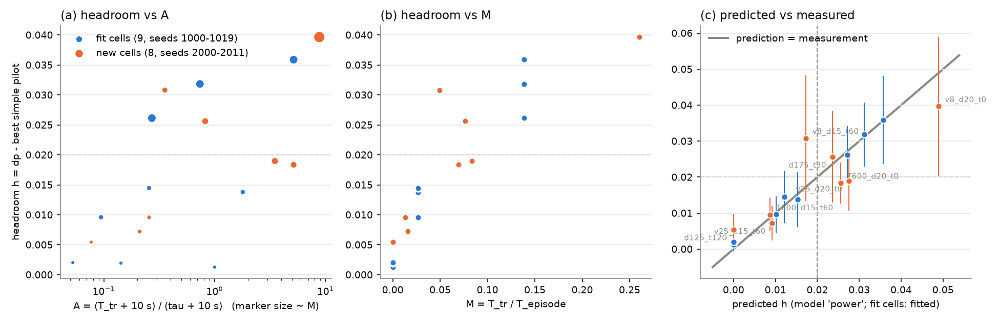

# Anticipation rule: pre-registered test on 8 new cells

Frozen fit (9 cells): model power, params [0.09542373398304549, 0.48, 0.2], fit R^2 = 0.986. Predictions from fit.json, unchanged.

## Verdict

- R^2 (1 - SS_res/SS_tot, predicted vs measured h, 8 new cells) = **0.576** (pass >= 0.7): **FAIL**  (Pearson r = 0.856, r^2 = 0.733, for information)
- correct room / no-room call at h >= 0.02: **5/8 = 62%** (pass >= 80%): **FAIL**
- overall: **RULE NOT CONFIRMED**

## All 17 cells

Announced bar: fit cells best of B6, B7, B8, B6fc_u, B6fc_a, B6dep; new cells best of B6, B6fc_u, B6fc_a, B6dep (by cell mean). h = paired mean dp - bar (95% CI). Unannounced bar: without B6fc_a and B6dep.

| cell | set | D m | tau s | v_max | T s | rho m | T_tr s | A | M | bar pilot | bar | dp | h ann. (95% CI) | h unann. | predicted / fitted h | call right |
|---|---|---|---|---|---|---|---|---|---|---|---|---|---|---|---|---|
| sites_d10_t0 | fit | 1000 | 0 | 15 | 300 | 670 | 0.0 | 1.000 | 0.0000 | B6dep | 0.888 | 0.890 | +0.0013 +/- 0.0018 | +0.0155 | 0.0000 (fit) | - |
| sites_d10_t60 | fit | 1000 | 60 | 15 | 300 | 670 | 0.0 | 0.143 | 0.0000 | B6dep | 0.888 | 0.890 | +0.0019 +/- 0.0013 | +0.0048 | 0.0000 (fit) | - |
| sites_d10_t180 | fit | 1000 | 180 | 15 | 300 | 670 | 0.0 | 0.053 | 0.0000 | B6dep | 0.884 | 0.886 | +0.0020 +/- 0.0013 | +0.0035 | 0.0000 (fit) | - |
| sites_d15_t0 | fit | 1500 | 0 | 15 | 300 | 690 | 7.9 | 1.794 | 0.0265 | B6dep | 0.837 | 0.851 | +0.0138 +/- 0.0077 | +0.0555 | 0.0153 (fit) | - |
| sites_d15_t60 | fit | 1500 | 60 | 15 | 300 | 690 | 7.9 | 0.256 | 0.0265 | B6dep | 0.834 | 0.849 | +0.0145 +/- 0.0073 | +0.0286 | 0.0121 (fit) | - |
| sites_d15_t180 | fit | 1500 | 180 | 15 | 300 | 690 | 7.9 | 0.094 | 0.0265 | B6dep | 0.823 | 0.833 | +0.0096 +/- 0.0050 | +0.0116 | 0.0102 (fit) | - |
| sites_d20_t0 | fit | 2000 | 0 | 15 | 300 | 688 | 41.6 | 5.161 | 0.1387 | B6dep | 0.743 | 0.779 | +0.0359 +/- 0.0123 | +0.0915 | 0.0357 (fit) | - |
| sites_d20_t60 | fit | 2000 | 60 | 15 | 300 | 688 | 41.6 | 0.737 | 0.1387 | B6dep | 0.745 | 0.777 | +0.0318 +/- 0.0089 | +0.0710 | 0.0311 (fit) | - |
| sites_d20_t180 | fit | 2000 | 180 | 15 | 300 | 688 | 41.6 | 0.272 | 0.1387 | B6dep | 0.732 | 0.758 | +0.0261 +/- 0.0081 | +0.0291 | 0.0272 (fit) | - |
| sites_v8_d15_t60 | NEW | 1500 | 60 | 8 | 300 | 690 | 14.9 | 0.356 | 0.0496 | B6dep | 0.790 | 0.821 | +0.0308 +/- 0.0175 | +0.0852 | 0.0173 | NO |
| sites_v25_d15_t60 | NEW | 1500 | 60 | 25 | 300 | 690 | 4.8 | 0.211 | 0.0159 | B6dep | 0.844 | 0.852 | +0.0072 +/- 0.0049 | +0.0157 | 0.0092 | yes |
| sites_v8_d20_t0 | NEW | 2000 | 0 | 8 | 300 | 688 | 78.0 | 8.802 | 0.2601 | B6dep | 0.712 | 0.751 | +0.0397 +/- 0.0193 | +0.1609 | 0.0489 | yes |
| sites_v25_d20_t0 | NEW | 2000 | 0 | 25 | 300 | 688 | 25.0 | 3.497 | 0.0832 | B6dep | 0.790 | 0.809 | +0.0190 +/- 0.0083 | +0.0571 | 0.0275 | NO |
| sites_T600_d20_t0 | NEW | 2000 | 0 | 15 | 600 | 688 | 41.6 | 5.161 | 0.0694 | B6dep | 0.807 | 0.825 | +0.0184 +/- 0.0057 | +0.0485 | 0.0256 | NO |
| sites_T600_d15_t60 | NEW | 1500 | 60 | 15 | 600 | 690 | 7.9 | 0.256 | 0.0132 | B6dep | 0.855 | 0.865 | +0.0096 +/- 0.0046 | +0.0197 | 0.0087 | yes |
| sites_d175_t30 | NEW | 1750 | 30 | 15 | 300 | 703 | 22.9 | 0.822 | 0.0763 | B6dep | 0.784 | 0.810 | +0.0256 +/- 0.0127 | +0.0756 | 0.0237 | yes |
| sites_d125_t120 | NEW | 1250 | 120 | 15 | 300 | 646 | 0.0 | 0.077 | 0.0000 | B6dep | 0.862 | 0.867 | +0.0054 +/- 0.0043 | +0.0097 | 0.0000 | yes |

### New cells: pilot means

| cell | n | B6 | B6fc_u | B6fc_a | B6dep | dp | teleport | secs/scenario |
|---|---|---|---|---|---|---|---|---|
| sites_v8_d15_t60 | 12 | 0.719 | 0.736 | 0.773 | 0.790 | 0.821 | 0.878 | 242 |
| sites_v25_d15_t60 | 12 | 0.832 | 0.836 | 0.826 | 0.844 | 0.852 | 0.878 | 130 |
| sites_v8_d20_t0 | 12 | 0.558 | 0.590 | 0.701 | 0.712 | 0.751 | 0.875 | 210 |
| sites_v25_d20_t0 | 12 | 0.745 | 0.752 | 0.764 | 0.790 | 0.809 | 0.875 | 111 |
| sites_T600_d20_t0 | 12 | 0.773 | 0.777 | 0.793 | 0.807 | 0.825 | 0.875 | 521 |
| sites_T600_d15_t60 | 12 | 0.842 | 0.845 | 0.847 | 0.855 | 0.865 | 0.883 | 515 |
| sites_d175_t30 | 12 | 0.729 | 0.734 | 0.760 | 0.784 | 0.810 | 0.873 | 237 |
| sites_d125_t120 | 12 | 0.857 | 0.857 | 0.848 | 0.862 | 0.867 | 0.891 | 258 |

Survival (share of new-cell scenarios lasting the episode): B6 100%, B6fc_u 100%, B6fc_a 100%, B6dep 100%, dp 100%.

## Gap decomposition on the G5 cells (val seeds 100-119, announced)

Chain dp -> best simple pilot -> B6 (greedy, no announcement) -> B3 (no altitude choice: the goto agent's controls, 150 m; full information) -> B3obsUN (same search, only the agent's information) -> best G5 round-1 agent. Paired means +/- 95% CI; the five parts add up to the total.

| cell | n | dp | bar (pilot) | B6 | B3 | B3obsUN | best agent | foresight dp - bar | announcement use bar - B6 | altitude B6 - B3 | information B3 - B3obsUN | learning B3obsUN - agent | total dp - agent | B6 check |
|---|---|---|---|---|---|---|---|---|---|---|---|---|---|---|---|
| sites_d20_t0_ann | 20 | 0.805 | 0.780 (B6dep) | 0.711 | 0.693 | 0.664 | 0.680 (sites_d20_t0_ann_goto_s1) | +0.024 +/- 0.008 | +0.069 +/- 0.016 | +0.019 +/- 0.012 | +0.028 +/- 0.018 | -0.016 +/- 0.022 | +0.125 +/- 0.019 | 0.0e+00 |
| sites_d20_t60_ann | 20 | 0.798 | 0.774 (B6dep) | 0.721 | 0.695 | 0.668 | 0.680 (sites_d20_t60_ann_goto_s1) | +0.023 +/- 0.008 | +0.054 +/- 0.013 | +0.025 +/- 0.010 | +0.028 +/- 0.016 | -0.012 +/- 0.019 | +0.118 +/- 0.015 | 0.0e+00 |

## POST HOC (not pre-registered): other transit definitions

Exploratory only; the verdict above stands. s x rho = footprint radius scaled by s in T_tr = max(0, D - 2 s rho) / v_max; s = 0 means T_tr = D / v_max. Power model as pre-registered.

| rho used | fit 9 -> new 8: R^2 | calls right | all 17: params (a, p, q) | in-sample R^2 | LOO RMSE |
|---|---|---|---|---|---|
| 1 x rho | 0.576 | 5/8 | 0.077, 0.46, 0.03 | 0.875 | 0.0051 |
| 0.5 x rho | -4.826 | 8/8 | 0.0802, 0.84, 0.25 | 0.845 | 0.0108 |
| 0 x rho | -6.129 | 8/8 | 0.0558, 0.92, 0.48 | 0.717 | 0.0098 |

