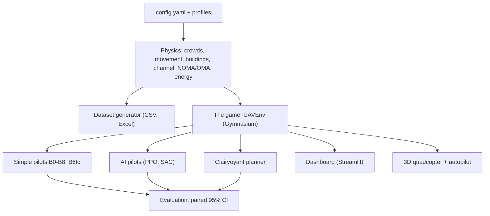
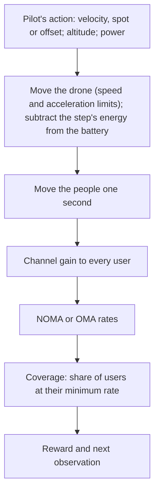
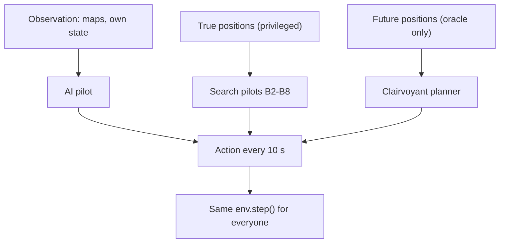
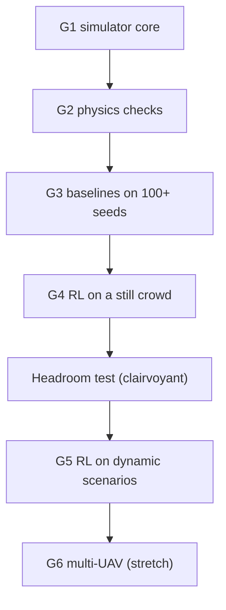
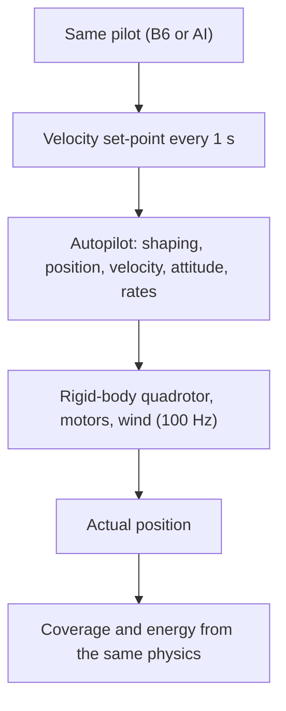

<!-- DRAFT of the final major-project report. Source of every number: the project book docs/book/ (chapter.section in the
HTML comment next to it). Items not yet in the book are marked "NOT IN BOOK" in the comment, with the file they come from.
Updated 2026-10-26 with the five finished studies: value of information (origin/contrib/value-of-info), anticipation rule
(origin/contrib/anticipation), hybrid timing AI (origin/rl/hybrid-timing), model mismatch (origin/exp/model-mismatch) and the
Kathmandu case (docs/case_nepal on main). The four study branches were not yet merged into main on that date.
Anything unfinished is marked [PENDING: ...]. Build the PDF with: python docs/report/build_report.py -->

<!-- titlepage -->
# UAV-NOMA Disaster Network Planning Simulator

A simulation-based planning tool for UAV base stations using NOMA in disaster areas, with a fair evaluation of reinforcement-learning control

A major project report submitted in partial fulfilment of the requirements for the award of the degree of

**Bachelor of Engineering / Bachelor of Technology in [PENDING: branch, e.g. Electronics and Communication Engineering]**

Submitted by

[PENDING: Student name 1, USN / roll number]

[PENDING: Student name 2, USN / roll number]

[PENDING: Student name 3, USN / roll number]

[PENDING: Student name 4, USN / roll number]

Under the guidance of

[PENDING: Guide name, designation, department]

[PENDING: Department of ..., College name, City]

[PENDING: Affiliated university]

[PENDING: Academic year, e.g. 2026-2027]
<!-- /titlepage -->

<!-- pagebreak -->

# Certificate

[PENDING: the university's certificate text, signed by the guide, the head of department and the principal, and the
external examiner's signature block, in the format prescribed by the university.]

This is to certify that the project work entitled "UAV-NOMA Disaster Network Planning Simulator: a simulation-based planning
tool for UAV base stations using NOMA in disaster areas" is a bonafide work carried out by [PENDING: names and USNs] in partial
fulfilment of the requirements for the award of the degree of [PENDING: degree] during the academic year [PENDING: year].

| Guide | Head of the Department | Principal |
|---|---|---|
| [PENDING: name, signature] | [PENDING: name, signature] | [PENDING: name, signature] |

<!-- pagebreak -->

# Declaration

We, the students named on the title page, declare that the work presented in this report is our own, carried out under the
guidance of [PENDING: guide], and has not been submitted for any other degree. Sources are cited in the References.

**Disclosure of AI assistance** [PENDING: confirm the wording against the university's policy]: much of the simulator, the
baseline pilots and the reinforcement-learning pipeline was first written in AI-assisted sessions (an AI coding assistant)
with the project owner, and the team then took ownership to review, explain and extend the code; every result was re-run,
checked and recorded in the project book.
<!-- src: book 1.5 (AI-assisted session; team re-scoped to own, review and extend, D-31) -->

[PENDING: place, date, signatures]

<!-- pagebreak -->

# Acknowledgement

[PENDING: thanks to the guide, the head of department, the principal, the institution, family and friends.]
The idea of a moving base station using NOMA came from our guide; the team extended it with moving crowds, collapsed
buildings, a battery limit and a learning controller.
<!-- src: book 1.2 -->

<!-- pagebreak -->

# Abstract

When an earthquake or a flood destroys the mobile towers in an area, a drone carrying a small base station can restore
service for a while, but where it should fly, how high, and how it should share its radio resources are open questions. We
built an open, tested, simulation-based planning tool for this problem: moving survivor crowds with five service classes,
collapsed buildings, the Al-Hourani air-to-ground channel, the Zeng-Xu-Zhang rotary-wing energy model with a battery, and a
NOMA downlink in which two users share one frequency slice. Every strategy flies the same seeded scenarios and is compared
with paired 95% confidence intervals, with pass marks written down before the results. Results: a drone that follows the
crowd serves 74 of every 100 people where a parked drone serves 43; when NOMA and OMA are optimised in the same way, adaptive
NOMA serves 3 to 5 more people per 100 for every pilot, and about 13 more for the best pilot in a scenario based on the 2024
Kathmandu floods with real OpenStreetMap buildings; circling at the minimum-power speed serves about 26% more people per
battery than hovering. A planner keeps 98% of its coverage when only half of the phones report a GPS position (one in twenty on
competing sites), even with 50 m error. A "clairvoyant" pilot that knows the future measures, before any training, whether an
AI has room to win at all: on walking crowds there is almost none (+0.002); room exists only where demand jumps between sites
about 2 km apart. A rule meant to predict that room from distance, speed and timing was not confirmed on new designs. The
learning pilots did not beat the best simple pilot anywhere: not on still crowds (0.576 against a pass mark of 0.580), not on
competing sites (best 0.680 against 0.756), not as a hybrid that only decides when to leave (-0.004 and -0.019), and not when
the true radio channel differs from the textbook model (-0.039 to -0.101). A simulated quadcopter with an autopilot flew the
same plans within 0.012 coverage of the simplified game. The result is an honest map of where learning helps and where a
computed rule is enough.
<!-- src: H1 0.741 vs 0.428 book 7.8 (rounded 74/43 as in docs/summary); NOMA +0.03..+0.05 book 13.9; Kathmandu B6 +0.127
docs/case_nepal/results.md; +25.6% book 7.10; value of information origin/contrib/value-of-info
docs/prereg/value_of_info_results.md; G4 0.576 vs 0.580 book 8.8; clairvoyant +0.002 book 7.11; anticipation rule
origin/contrib/anticipation docs/prereg/anticipation/results_summary.md; G5 round 1 book 8.9; hybrid
origin/rl/hybrid-timing uav_dataset/results/hybrid/summary.md; mismatch origin/exp/model-mismatch
docs/prereg/model_mismatch_results.md; sim-to-sim -0.003..-0.012 book 4.9 -->

**Keywords:** UAV base station, NOMA, disaster communication, air-to-ground channel, rotary-wing energy, reinforcement
learning, baselines, simulation-based planning.

<!-- toc -->

# List of figures

| No. | Title | Section |
|---|---|---|
| 3.1 | System architecture: one physics engine, one game, many pilots | 3.1 |
| 3.2 | One second of the game | 3.3 |
| 3.3 | How each pilot reaches the game | 3.7 |
| 3.4 | The evaluation protocol and the gates | 3.9 |
| 3.5 | The 3D quadcopter in the loop (sim-to-sim) | 3.10 |
| 5.1 | Four training scenarios: crowds, scattered users and rescue users | 5.1 |
| 5.2 | Best altitude per user class | 5.1 |
| 5.3 | Seven pilots on the `hard` profile | 5.2 |
| 5.4 | Pilots on one hard scenario with moving crowds | 5.2 |
| 5.5 | NOMA vs OMA in the game, hard profile | 5.3 |
| 5.6 | NOMA pairs on the map and every user's rate | 5.3 |
| 5.7 | Four access schemes, hard profile | 5.3 |
| 5.8 | Four access schemes, low-power profile | 5.3 |
| 5.9 | First AI pilot (velocity control) drifting away from the crowd | 5.6 |
| 5.10 | Waypoint control with a 10-second decision rhythm | 5.6 |
| 5.11 | Best AI (E0) vs grid search on validation scenario 105 | 5.6 |
| 5.12 | Circling vs hovering | 5.4 |
| 5.13 | Room for a pilot that thinks ahead, fresh scenarios | 5.7 |
| 5.14 | The anticipation rule: fit and test | 5.7 |
| 5.15 | The 3D flight page (simulated quadcopter) | 5.10 |
| 5.16 | How many phones must report their position | 5.11 |
| 5.17 | The Kathmandu scenario: buildings, river, flood band and people | 5.12 |
| 5.18 | NOMA vs OMA, Kathmandu and synthetic `hard` | 5.12 |

# List of tables

| No. | Title | Section |
|---|---|---|
| 1.1 | Hypotheses | 1.4 |
| 2.1 | Literature matrix | 2.7 |
| 3.1 | Scenario profiles | 3.2 |
| 3.2 | User classes and minimum rates | 3.2 |
| 3.3 | The pilots | 3.7 |
| 4.1 | Code structure | 4.2 |
| 4.2 | Dataset tables | 4.4 |
| 5.1 | H1: pilots on the `hard` profile | 5.2 |
| 5.2 | H3: fixed NOMA vs OMA in the game | 5.3 |
| 5.3 | H3: adaptive NOMA vs equally optimised OMA | 5.3 |
| 5.4 | Circling vs hovering | 5.4 |
| 5.5 | The information ladder | 5.5 |
| 5.6 | Gate G4 runs | 5.6 |
| 5.7 | Clairvoyant headroom on walking crowds | 5.7 |
| 5.8 | Room in the competing-sites designs | 5.7 |
| 5.9 | Room confirmed on fresh scenarios | 5.7 |
| 5.10 | The anticipation rule on 8 new designs | 5.7 |
| 5.11 | G5 round 1 | 5.8 |
| 5.12 | Hybrid timing AI | 5.8 |
| 5.13 | The AI's shortfall split into parts | 5.8 |
| 5.14 | Model mismatch: room test | 5.9 |
| 5.15 | Model mismatch: the AI against the bar | 5.9 |
| 5.16 | Sim-to-sim check | 5.10 |
| 5.17 | Value of location information | 5.11 |
| 5.18 | Kathmandu case: pilots, NOMA and OMA | 5.12 |
| 6.1 | Where each tool fits | 6.1 |
| 7.1 | Hypotheses: verdicts | 7.1 |
| 7.2 | Path to real deployment (find-and-serve) | 7.3 |

<!-- pagebreak -->

# Chapter 1. Introduction

## 1.1 Problem statement
After an earthquake, a cyclone or a flood, the ground mobile network in the affected area often fails: towers lose power,
backhaul cables break and buildings collapse. Survivors cannot call for help and rescue teams cannot coordinate. A drone
(unmanned aerial vehicle, UAV) carrying a small base station can act as a temporary tower. Three things make this hard:
1. the drone's battery lasts minutes, not hours, and flying (not the radio) dominates its energy use;
2. the air-to-ground signal depends on the drone's height and position, and collapsed buildings block some links;
3. survivors move, sometimes suddenly, and one drone must share its bandwidth and power among hundreds of people with
   different needs.

The planning question is therefore: **where should the drone fly, how high, and how should it share its radio resources over
time so that as many survivors as possible stay connected before the battery runs out?**
<!-- src: book 1.1 -->

## 1.2 Motivation
- Restoring a basic connection quickly matters more in a disaster than giving already-served users a fast one. This defines
  our main metric, **coverage**: the share of users who receive at least the minimum data rate of their class.
- Non-orthogonal multiple access (**NOMA**) lets two users share the same frequency slice at the same time by splitting power,
  so a power- and bandwidth-limited drone can serve more people. The guide's original idea was a moving base station using NOMA.
- Rescue planners cannot rehearse drone strategies on real disasters. A **simulation-based planning tool** lets strategies be
  compared fairly in software before any flight, saving hardware, battery and flight time. We deliberately do not call it a
  digital twin: that term needs live or replayed state data, which this project does not have.
- Reinforcement learning (RL) is often proposed for UAV control. We wanted to know honestly **when** a learned controller beats
  strong non-learning strategies and when it does not.
<!-- src: book 1.2, 13.1, D-30 -->

## 1.3 Objectives
1. Build an open, tested, reproducible simulator of a UAV base station serving moving survivor crowds with a NOMA downlink,
   with every physical parameter sourced or labelled as an engineering assumption.
2. Build strong non-learning pilots (baselines) and a fair evaluation protocol (same scenarios, paired statistics, fixed
   train/validation/test seeds, pass marks written down before results).
3. Measure NOMA against OMA inside the mission, for every pilot, including an equally optimised OMA.
4. Train RL pilots that learn by themselves from raw measurements and report where they win and lose.
5. Measure the room any anticipating controller could have (a clairvoyant upper bound) before spending effort on training.
6. Check that the simplified flight model does not distort the conclusions, by flying the same plans with a simulated
   quadcopter and autopilot.
7. Provide a dashboard so that non-specialists can set up a disaster, fly any pilot and compare them.
8. Measure how much phone position information a planner needs, and test whether learning helps when the real radio
   channel differs from the textbook model.
9. Run the pilots on a scenario based on a real place (real buildings, reconstructed people) to check that the conclusions
   survive real geometry.
<!-- src: book 1.3, 1.6, roadmap stages 1-5; items 8-9 added by D-56 and the studies of 23-24 Oct 2026 -->

**Wording rule.** "Simulation-based planning tool", never "digital twin": the project has no live state synchronisation and no
replayed real traces. A scenario built on a real map is called "a scenario based on ..." and its people are never called real
data.

## 1.4 Hypotheses
Every experiment serves one of these hypotheses.

*Table 1.1 Hypotheses*

| ID | Hypothesis | In plain words |
|---|---|---|
| H1 | Adaptive UAV control beats a fixed UAV once crowds move | A drone that follows people does better than one parked in the middle |
| H2 | RL beats strong heuristics (k-means, grid search, particle swarm) only when dynamics and battery limits make them short-sighted; report where it wins and where it does not | The AI should only win in hard, changing situations, and we must say where it loses |
| H3 | NOMA pairing improves throughput and coverage over OMA at equal bandwidth and power | Sharing a slice between two people beats giving everyone a separate slice |
| H4 (stretch) | Coordinated multi-UAV control beats independent placement | Several drones working together beat drones acting alone |
<!-- src: book 1.3 -->

## 1.5 Scope
**In scope:** one UAV; 2 x 2 km and 1 x 1 km areas; 100-1,000 users in 2-5 crowds; six crowd-movement models and
competing-site events; collapsed buildings as 2D rectangles; the Al-Hourani mean path loss with optional fading; the
Zeng-Xu-Zhang energy model with a battery; NOMA (fixed and adaptive) and OMA downlinks; non-learning pilots (B0-B8, B6fc,
B6dep and diagnostic variants), PPO and SAC agents, a hybrid timing agent; a clairvoyant planner; a simulated quadcopter with an
autopilot; a Streamlit dashboard; one case study on real building footprints (a 2 x 2 km area of Kathmandu from
OpenStreetMap, with a height-aware line-of-sight test), with the people reconstructed from assumptions.
<!-- src: book 4.1-4.7, 7.1 (B0-B8 + B6fc), 8.8, 7.11; quadcopter: book 4.9; B6dep: anticipation prereg; Kathmandu:
docs/case_nepal/README.md -->

**Out of scope:** real hardware and flight tests; terrain, and building heights outside the one real-map case; the drone's
own backhaul; interference from other cells; bit-error rate; locating survivors from their phones (future work, Section 7.3);
more than one drone (H4 was not attempted). All results are conditional on the model: they may be used to compare strategies
under the stated assumptions, not to predict absolute coverage in a real disaster.
<!-- src: book 4.9, 10.5 -->

## 1.6 Organisation of the report
Chapter 2 surveys the literature by theme. Chapter 3 describes the system design. Chapter 4 covers the implementation, testing
and reproducibility. Chapter 5 presents the results, hypothesis by hypothesis, then the studies of location information and
the Kathmandu case. Chapter 6 discusses where learning helps, the limitations and threats to validity. Chapter 7 concludes,
lists future work and describes the next study, finding survivors from their phones.

<!-- pagebreak -->

# Chapter 2. Literature survey

The survey is organised by the six themes the project touches. The full matrix with links, and what we took from each paper,
is in `docs/report/literature.md`. **Every entry still needs a person to check it against the original** (marked VERIFY there);
of the two papers used for parameters, only [2] was read in full.
<!-- src: book 10.2, 10.4 item 5 -->

## 2.1 UAV base-station placement
A UAV base station's coverage depends on its 3D position. Bor-Yaliniz, El-Keyi and Yanikomeroglu [5] formulate 3D placement
of one aerial base station as a mixed-integer non-linear problem and give an efficient numerical solution. Alzenad et al. [6]
place a UAV base station to cover the most users with the least transmit power. Lyu, Zeng, Zhang and Lim [7] place several
UAV-mounted base stations along a spiral to cover all ground terminals with as few drones as possible. Mozaffari et al. [4]
survey placement, trajectory, energy and channel modelling for UAVs in wireless networks. These works optimise placement for a
known, mostly static user set; our search pilots B3, B4 and B6 are simple members of this family (grid search, particle swarm
[31]), used as strong baselines rather than as contributions.

## 2.2 The air-to-ground channel
Al-Hourani, Kandeepan and Lardner [1] give a closed-form probability of line of sight between a low-altitude platform and a
ground user as a function of the elevation angle, and show that an optimal altitude exists for maximum coverage. The mean path
loss is the free-space loss plus an excess loss weighted by the line-of-sight probability. We use this model with
a = 9.61, b = 0.16, eta_LoS = 1 dB and eta_NLoS = 20 dB at 2 GHz. **The original letter was not read** (paywalled); the formulas
and parameter values were checked in two secondary papers that cite it [27], [28], which list them without naming the
environment, so the label "urban" is unconfirmed.
<!-- src: book 4.5, 10.2, journal 17 -->

## 2.3 Rotary-wing energy
Zeng and Zhang [3] model the propulsion energy of a fixed-wing UAV and propose a circular trajectory with optimised radius and
speed for energy efficiency. Zeng, Xu and Zhang [2] derive the propulsion power of a rotary-wing UAV as a function of speed:
blade profile power, induced power and parasite power. Its key consequence for us is that moderate forward flight costs less
than hovering. We verified the formula and constants (delta, k, rho, s) in [2] and derived our own small 20 N drone from it
(hover 168.49 W); the fuselage drag ratio d0 = 0.6 is unverified ([2] uses 0.3).
<!-- src: book 4.7, 10.2, assumptions.md -->

## 2.4 NOMA and UAV-NOMA
Saito et al. [8] proposed power-domain NOMA with successive interference cancellation (SIC) for cellular radio access. Ding,
Fan and Poor [9] show that with fixed power allocation, pairing users with very different channels enlarges NOMA's gain over
OMA, and they study cognitive-radio-inspired NOMA in which the weak user's rate is protected. Liu et al. [10] present a
framework for UAV communications based on NOMA. Cui et al. [11] jointly design the UAV trajectory and resource allocation
for OMA and NOMA under max-min fairness. Chen et al. [12] allocate power in a NOMA-UAV network flying a circular trajectory,
with a secrecy constraint. Our fixed scheme (strongest paired with weakest, 0.8/0.2 split) follows the fixed-allocation idea of
[9]; our adaptive scheme gives each pair its minimum power in closed form, which is close in spirit to the rate-protecting
allocation of [9].

## 2.5 Reinforcement learning for UAV networks
Deep RL has been applied to UAV base stations many times. Ghanavi et al. [16] use Q-learning to place an aerial base station
for moving users. Liu, Liu, Chen and Hanzo [15] design trajectories and power control for multi-UAV networks with machine
learning. Zhong et al. [13] combine k-means with a deep Q-network to control the 3D trajectory and power of a UAV offloading
NOMA users. AdaptSky [14] uses deep RL for joint NOMA power allocation and UAV placement. Hu et al. [17] use meta-RL so that an
energy-limited UAV adapts its trajectory quickly to new demand. Rizvi and Boyle [18] use multi-agent RL with action masking for
UAV mobile communications, and Wang et al. [19] split beamforming (fast, graph network) from trajectory (slow, multi-agent RL)
in a two-layer design. **So the method is not new: we cannot claim to be the first to apply RL to UAV-NOMA.** In the papers we
looked at, RL is usually compared with random, circular or OMA references; comparisons against strong search pilots on the
same scenarios with paired statistics were rarer (to be checked across the full matrix).
<!-- src: book 11.2 -->

The learners we use are PPO [20] and SAC [21] from Stable-Baselines3 [23], in a Gymnasium environment [24]. The privileged
("asymmetric") critic that sees the true state during training only follows Pinto et al. [22].

## 2.6 Evaluation practice
Henderson et al. [25] showed that deep-RL results vary strongly with random seeds and implementation details, and that few
seeds can produce misleading conclusions. Agarwal et al. [26] recommend interval estimates and robust aggregate metrics rather
than point scores. We follow both: fixed seed splits, several training runs, paired confidence intervals, a Holm correction
[29] where many comparisons are made, Jain's fairness index [30] as a secondary metric, and pass marks written down before
results are seen.

## 2.7 Literature matrix

*Table 2.1 Literature matrix (short form; details and links in literature.md; every entry: VERIFY)*

| Ref. | Theme | Main idea | What we take or compare |
|---|---|---|---|
| [1] Al-Hourani 2014 | Channel | LoS probability vs elevation; optimal altitude | Our channel model and parameters |
| [2] Zeng, Xu, Zhang 2019 | Energy | Rotary-wing propulsion power | Our energy model; forward flight cheaper than hover |
| [3] Zeng, Zhang 2017 | Energy | Fixed-wing energy; circular trajectory | Motivation for the circling pilot B7 |
| [4] Mozaffari 2019 | Survey | UAVs in wireless networks | Problem framing |
| [5] Bor-Yaliniz 2016 | Placement | 3D placement as an optimisation | Search pilots as baselines |
| [6] Alzenad 2017 | Placement | Energy-efficient maximal coverage placement | Coverage as the objective |
| [7] Lyu 2017 | Placement | Spiral placement of several UAV base stations | Multi-UAV future work (H4) |
| [8] Saito 2013 | NOMA | Power-domain NOMA with SIC | NOMA principle |
| [9] Ding, Fan, Poor 2016 | NOMA | User pairing; fixed vs rate-protecting power | Extreme pairing; adaptive split |
| [10] Liu 2019 | UAV-NOMA | Framework for NOMA-based UAV networks | Context for H3 |
| [11] Cui 2019 | UAV-NOMA | Joint trajectory and resource allocation, OMA vs NOMA | Fair OMA reference |
| [12] Chen 2020 | UAV-NOMA | Power allocation on a circular trajectory | Circling with NOMA |
| [13] Zhong 2020 | RL + NOMA | k-means + DQN for trajectory and power | Shows RL-for-UAV-NOMA is published |
| [14] Benfaid 2021 | RL + NOMA | DRL for NOMA power and placement | Same |
| [15] Liu 2018 | RL | Multi-UAV trajectory and power control by ML | Same |
| [16] Ghanavi 2018 | RL | Q-learning placement for moving users | Closest to our G5 task |
| [17] Hu 2020 | RL | Meta-RL trajectories for an energy-limited UAV | Adapting to new demand |
| [18] Rizvi, Boyle 2023 | RL | Multi-agent RL with action masking | Action design; H4 |
| [19] Wang 2026 | RL | Two-layer, two-timescale RL for multi-UAV | Supports our time-scale split |
| [20] Schulman 2017 | Method | PPO | Our main learner |
| [21] Haarnoja 2018 | Method | SAC | Our second learner |
| [22] Pinto 2017 | Method | Asymmetric actor-critic | Privileged critic (training only) |
| [23] Raffin 2021 | Tool | Stable-Baselines3 | Implementation of PPO and SAC |
| [25] Henderson 2018 | Evaluation | Seed variance in deep RL | Several runs per version |
| [26] Agarwal 2021 | Evaluation | Interval estimates for RL results | Confidence intervals, pass marks |

## 2.8 Gap and positioning
From the survey, the defensible contribution is not a new algorithm but **an open, tested simulator and evaluation protocol for
UAV-NOMA planning in disaster scenarios, a comparison of learning against strong non-learning pilots across regimes, and an
analysis of when learning helps**, together with specific findings:
1. **H1:** an adaptive drone beats a parked one where the area is large and power scarce (0.741 vs 0.428), and most of a search
   pilot's lead can come from choosing the altitude.
2. **H3:** NOMA's gain measured inside the mission for every pilot, against an equally optimised OMA (+0.03 to +0.05), and
   about twice as large for the best pilot on real building geometry (Kathmandu case, +0.127).
3. **Energy:** circling at the minimum-power speed serves about 26% more people per battery than hovering.
4. **Clairvoyant headroom:** a method for deciding, before any training, whether a scenario leaves any room for a learning
   controller at all.
5. **Value of location information:** a design rule for how many phones must report their position, how accurately and how
   often (pre-registered, passed).
6. **Sim-to-sim:** the coverage conclusions survive a realistic quadcopter with an autopilot and wind.
7. **An honest map of where AI does and does not help**, including four pre-registered negative results and one rule that was
   not confirmed (the anticipation rule).
<!-- src: book 11.2, D-56; new results from the branches named in Chapter 5 -->

Drone systems that locate phones from the air for search and rescue have been described in a paper and in industry reports
([33], [35]; both still to be verified against the originals). Our project does not locate phones; it plans a drone that serves
them. Joining the two ("find-and-serve") is the next study (Section 7.3).

<!-- pagebreak -->

# Chapter 3. System design

## 3.1 Architecture
The design principle is **one physics code path**: the dataset generator, the game (Gymnasium environment), every pilot, the
AI, the dashboard and the 3D quadcopter all call the same functions in `make_dataset.py`, so they cannot disagree. Everything
below the game is plain Python and NumPy with no user-interface or RL dependency, and every setting lives in `config.yaml`.
<!-- src: book 4 intro, CLAUDE.md conventions -->

*Figure 3.1 System architecture: one physics engine, one game, many pilots*



## 3.2 Scenarios
A scenario is one invented disaster area identified by a seed; the same seed always gives the same crowd, buildings and
movement. Each seed draws the number of users (100, 300, 600 or 1,000), 2-5 clusters with radius 50-200 m, 5-10% scattered
users, the movement model and the buildings. Seeds are split and never mixed: **train 0-99, validation 100-119, test 120-139**;
the RL agents later trained on fresh seeds 10,000-19,999. Named profiles change only what they name.
<!-- src: book 4.1, 8.8 -->

*Table 3.1 Scenario profiles*

| Profile | Changes from the default (1 x 1 km, 30 dBm, 0-5 buildings, five movement models, 10 Wh) |
|---|---|
| `lowpower` | 20 dBm |
| `bigarea` | 2 x 2 km |
| `hard` | 2 x 2 km, 20 dBm, 3-8 buildings of 60-200 m, only hotspot jump / surge / group drift / attraction, 16 Wh |
| `rl_static` | as `hard` but the crowd stands still (RL curriculum step 1) |
| `sites_d{10,15,20}_t{0,60,180}` | 2-3 sites 1.0-2.0 km apart; 50-70% of the demand switches from site A to B at 60-150 s, at once or over 1 or 3 minutes; G5 settings inside |
| `sites_v*`, `sites_T600_*`, `sites_d175_t30`, `sites_d125_t120` | Eight new competing-sites designs for testing the anticipation rule: drone top speed 8 or 25 m/s, a 600 s mission, or new distances and switch times |
| `mm_*` | `rl_static` with G5 settings, and a TRUE radio world that differs from the planners' textbook model: correlated shadowing, a 25 dB building loss (planners assume 15 dB) and buildings missing from the planners' map |
| `place_kathmandu_bagmati` | A 2 x 2 km area of Kathmandu along the Bagmati river: 12,061 real building footprints from OpenStreetMap, height-aware line of sight, a reconstructed flood crowd that does not walk, an evacuation event; 20 dBm, 16 Wh, G5 settings |
<!-- src: book 4.1, 7.12, D-52; anticipation prereg (origin/contrib/anticipation docs/prereg/anticipation_rule.md);
mismatch prereg (origin/exp/model-mismatch docs/prereg/model_mismatch.md); docs/case_nepal/README.md -->

Every person belongs to a class that sets the minimum rate needed to count as served.

*Table 3.2 User classes and minimum rates (engineering assumptions, not yet signed off)*

| Class | Share | Minimum rate |
|---|---|---|
| rescue | 10% | 200 kbps |
| video | 20% | 500 kbps |
| voice | 30% | 50 kbps |
| iot | 20% | 10 kbps |
| normal | 20% | 100 kbps |
<!-- src: book 4.2, D-04 -->

**Movement.** Six models move every person each second for 300 s, vectorised over users: static; random waypoint (0.5-1.5
m/s); group drift; attraction to 1-2 shelters; hotspot jump (one crowd relocates at 3 m/s at a random moment between 60 and
180 s); surge (everyone runs to one point at 3 m/s). In the competing-sites profiles an activity mask switches users off at
site A and equally many on at site B, so crowd size, class mix and bandwidth stay the same.
<!-- src: book 4.3, 7.12 -->

**Collapsed buildings.** Axis-aligned rectangles; a drone-user link whose 2D segment crosses one gets 15 dB extra loss
(engineering assumption, range 10-25 dB), tested with the vectorised slab (Liang-Barsky) method.
<!-- src: book 4.4 -->

## 3.3 The radio channel
For a drone at (X, Y, H) and a user at (x, y), following Al-Hourani et al. [1]:

```
d      = sqrt((x - X)^2 + (y - Y)^2 + H^2)
theta  = (180 / pi) * arcsin(H / d)                          elevation angle in degrees
P_LoS  = 1 / (1 + a exp(-b (theta - a)))                      a = 9.61, b = 0.16
PL_dB  = FSPL(d, 2 GHz) + P_LoS * 1 dB + (1 - P_LoS) * 20 dB   (+ 15 dB if a building blocks the link)
noise  = -174 dBm/Hz + 7 dB noise figure, over each user's bandwidth
```
Optional fading (Rician K = 10 dB for LoS, Rayleigh for NLoS) is off for the dataset and the baselines. Bandwidth scales with
the crowd: 50 kHz per user.
<!-- src: book 4.5, D-03 -->

**On a real map (Kathmandu case only).** Al-Hourani's P_LoS is a statistical stand-in for buildings whose positions are
unknown. Where the buildings are known, the simulator instead draws the straight 3D line from each phone (1.5 m above the
ground or the roof it stands on) to the drone over a 2 m height grid of the footprints: a clear ray gets FSPL + 1 dB, a ray
that passes below a roof gets FSPL + 20 dB (the same two Al-Hourani terms). Using both P_LoS and the known buildings would
count the buildings twice; that variant is kept as a sensitivity run. No diffraction, trees, terrain or indoor users.
<!-- src: docs/case_nepal/README.md section 3 -->

*Figure 3.2 One second of the game*



## 3.4 NOMA and OMA
**Plain words.** OMA gives every person a separate slice of the bandwidth. NOMA puts two people on the same slice: the weak
user gets most of the power and reads its own message treating the other as noise; the strong user first decodes and removes
the weak user's message (SIC) and then reads its own.

**Four access schemes, all with the same total bandwidth B and power P** (N users):
1. `oma`: FDMA, each user gets B/N and P/N.
2. `noma` (fixed): users sorted by channel gain, strongest paired with weakest; each pair gets 2B/N and 2P/N, split 0.8 to the
   weak user and 0.2 to the strong user (formulas below).
3. `oma_opt`: each user gets the minimum power for its rate, p_i = (2^(R_i/b) - 1) N0 b / g_i; users are admitted cheapest
   first while the total stays within P; leftover power is scaled up evenly.
4. `noma_opt` (adaptive NOMA): the same cheapest-first admission, then the admitted users are paired strongest with weakest on a
   double slice and each pair gets its minimum NOMA power in closed form, with an imperfect-SIC residual eps (formulas below).
   If NOMA would cost more than serving the pair separately (possible only with eps > 0), the pair uses OMA inside its slot.
   The largest number of users that fits is found by binary search; options `sic_eps` (0 or 0.05) and `rescue_first`.

```
fixed NOMA:     SINR_weak   = 0.8 p g_w / (0.2 p g_w + N0)
                SINR_strong = 0.2 p g_s / N0                  (after SIC)
                R = b log2(1 + SINR)
adaptive NOMA:  p_s = gamma_s N (eps gamma_w / g_w + 1 / g_s) / (1 - eps gamma_s gamma_w)
                p_w = gamma_w (p_s + N / g_w),      gamma = 2^(R / 2b) - 1
```
<!-- src: book 4.6, 13.2, 13.9, D-39 -->

From G5 on, the project uses `noma_opt` with eps = 0.05 and rescue users admitted first, and always reports `oma_opt` next to it
so that H3 stays a fair test.
<!-- src: D-48 -->

## 3.5 Energy and battery
Rotary-wing propulsion power after Zeng, Xu and Zhang [2]:
```
P(V) = P0 (1 + 3 V^2 / Utip^2) + Pi sqrt( sqrt(1 + V^4 / (4 v0^4)) - V^2 / (2 v0^2) ) + 0.5 d0 rho s A V^3
hover P(0) = P0 + Pi = 79.86 + 88.63 = 168.49 W
energy per 1 s step = P(V) + W max(climb rate, 0) + P_tx / 0.4 + 5 W
```
For our 20 N drone: Utip = 120 m/s, v0 = 4.03 m/s, d0 = 0.6, rho = 1.225 kg/m^3, s = 0.05, A = 0.503 m^2. Flying at about
10 m/s costs 133.5 J/s against 176.0 J/s hovering (30 dBm, including radio and electronics). An acceleration limit (4 m/s^2
horizontal) and a load-factor term for turning and braking (our own extension, labelled as such) close a "shaking" exploit in
which a drone could stay in place at forward-flight power.
<!-- src: book 4.7, D-13, D-44..D-46 -->

## 3.6 The game (Gymnasium environment)
`UAVEnv` plays one scenario second by second for 300 s or until the battery is empty. The drone starts at the map centre at
150 m, flies at most 15 m/s horizontally and 5 m/s vertically, between 50 and 300 m. The reward is the coverage of the second;
each reward part is logged separately so that reward hacking can be spotted. The observation contains only what a real drone
could measure: its position, velocity, battery and time, its previous coverage, throughput and fairness, and coarse 10 x 10 maps
of where users and rescue users are. Later versions added an uncapped map, the number of connected users, the drone's own
history and, in the competing-sites cells, the operator's announcement of the event. Pilots can control velocity (`xy`),
fly to a spot (`goto`), or move by an offset (`moveby`, 0 = stay), and the AI decides every 10 s.
<!-- src: book 6.1, 6.2, 8.8, D-19, D-20, D-54, D-55 -->

**The rule about the AI** (owner's decision): the AI learns by itself from raw measurements and the coverage score. No hints,
no menu of candidate spots, no imitation of the baselines, no privileged information when flying. A critic that sees the true
state during training only was allowed later and is disclosed wherever used.
<!-- src: book 1.7, D-24, D-38 -->

## 3.7 Pilots
The baselines see the true user positions (privileged information); the AI sees only maps. That makes them a strong test.

*Table 3.3 The pilots*

| ID | Name | What it does |
|---|---|---|
| B0 | Fixed | Parks at the map centre at 150 m, full power |
| B1 | Follow the crowd | Flies toward the centre of the biggest true cluster |
| B2 | Weighted k-means | Every 10 s: k = 3 clusters (rescue users count 3x), flies to the heaviest |
| B3 | Grid search | Every 10 s: scores a grid of spots at 150 m, flies to the best |
| B4 | Particle swarm (PSO) | Every 10 s: searches position, altitude and power |
| B5 | Energy-aware | Like B3 but moves only if the gain pays for the energy; behaves like B3 because moving is cheaper than hovering |
| B6 | Grid search + altitude | Like B3 with five altitudes per spot |
| B7 | Circling | Chooses spots like B6 but circles them (50 m) at the minimum-power speed |
| B8 | Battery rule | Like B6; circles once the battery would not last |
| B6fc | Forecasting | Like B6, also using the announced event schedule (competing sites) |
| B6dep | Departure time | B6 plus *when* to leave for the announced site: every 10 s it compares "stay until time d, then fly" for every d, with B6fc's forecast |
| B6rep, B3rep | Phone reports | B6's / B3's search on positions reported by a share of the phones, with GPS error and age (value of information) |
| B6meas | Measure and search | Textbook model to pick a few spots, then flies there, measures its real coverage and searches locally (model mismatch) |
| B6true | Upper bound (mismatch) | B6 with a finer search on the TRUE channel; not a competitor |
| B3obs, B3obsU, B3obsUO | Information ladder | B3's search using only the AI's maps (diagnostic) |
| Clairvoyant | Upper bound | Knows the crowd's whole future; dynamic programming over B6's grid |
| AI | PPO / SAC | Neural network trained by RL; sees only raw measurements |
| Hybrid | B6 + PPO | B6 decides where; a small PPO policy decides only when to leave for the announced site (disclosed as a hybrid) |
<!-- src: book 7.1, 7.11, D-52, D-37; B6dep: anticipation_rule.md section 2; B6rep: value_of_info.md section 2; B6meas,
B6true: model_mismatch.md section 4; hybrid: hybrid_timing.md section 2 -->

*Figure 3.3 How each pilot reaches the game*



## 3.8 The AI
PPO [20] (and SAC [21] for comparison) from Stable-Baselines3 [23]. Two network types: a two-layer MLP (64 units) and a small
CNN that reads the maps as a picture with coordinate channels. The best still-crowd version (E0) uses a dictionary observation
with uncapped maps, the crowd size and the last 4 positions and coverages, fresh training scenarios and a planning horizon
gamma = 0.95 matched to 30 decisions per mission. Training runs on a laptop CPU (about 1,000 simulated seconds per second when
plugged in) and, for G5, on Kaggle.
<!-- src: book 6.3, 6.4, 8.8, D-55 -->

## 3.9 The evaluation protocol
- Main metric **coverage_full**: coverage averaged over the 300 s mission, counting zero after the battery dies.
- Mean and 95% confidence interval over scenarios; **paired differences** per scenario (pilot A minus pilot B on the same
  scenario) so that "this scenario was easy for everyone" cancels; a `*` marks a CI that excludes zero.
- Holm correction where a table makes many comparisons.
- Pass marks fixed **before** results are seen (G4: D-43; competing sites: D-52; G5: D-55); test seeds read once at the end.
- Gates: a layer starts only after the previous gate passes.
<!-- src: book 7.2, 13.9, D-43, D-52, D-55, 1.4 -->

*Figure 3.4 The evaluation protocol and the gates*



## 3.10 The dashboard and the 3D quadcopter
**Dashboard.** A Streamlit web page on the same engine, with pages to see the showcase, fly a disaster with any pilot, compare
pilots, get a plan with battery advice, and (since Stage 5) watch a 3D flight. Its numbers equal the experiments' because it
calls the same code; 16 tests check this without Streamlit.
<!-- src: book 9.4 (test_dashboard_core 16), D-50, roadmap parallel tracks; 3D page: book 4.9 -->

**Simulated quadcopter (Stage 5).** In the game the drone moves like a chess piece. In Stage 5 every pilot's velocity command
instead becomes the set-point of an autopilot (like ArduPilot GUIDED velocity mode) flying a rigid-body quadrotor model of the
same 2.04 kg drone: thrust and attitude dynamics, a first-order motor lag, rotor and fuselage drag, a 30 degree tilt limit, a
thrust-to-weight ratio of 2, a geofence, and wind with seeded gusts, integrated at 100 Hz. Energy is still computed by the
Zeng model, from the airspeed, climb and acceleration of every integration step. The autopilot values quoted from ArduPilot and
PX4 are marked as not verified.
<!-- src: book 4.9; mass, tilt, thrust-to-weight and 100 Hz from the quadsim.py docstring and commit 233827e -->

*Figure 3.5 The 3D quadcopter in the loop (sim-to-sim)*



<!-- pagebreak -->

# Chapter 4. Implementation

## 4.1 Tools
Python with NumPy, pandas, matplotlib, PyYAML, Gymnasium, pytest, xlsxwriter and openpyxl for the simulator and the
baselines; Stable-Baselines3, PyTorch (CPU) and TensorBoard for the AI; Streamlit for the dashboard; ReportLab for the PDF
documents. Development on Windows 11 (laptop CPU); continuous integration on GitHub with Python 3.11 and 3.12.
<!-- src: book 9.1, 9.6 -->

## 4.2 Code structure

*Table 4.1 Code structure (`uav_dataset/`)*

| File | Role |
|---|---|
| `config.yaml` | Every setting and profile; values are changed here, never in the code |
| `make_dataset.py` | Physics, scenarios, movement, buildings, channel, NOMA/OMA access schemes, energy, dataset tables |
| `uav_env.py` | The Gymnasium game |
| `baselines.py` | Pilots B0-B8, B6fc and the information-ladder pilots |
| `run_baselines.py`, `evalstats.py` | Runner and statistics (mean +/- 95% CI, paired differences) |
| `rl_utils.py`, `rl_net.py`, `rl_train.py`, `rl_eval.py` | Control modes, decision hold, CNN, training and evaluation |
| `oracle.py` | Clairvoyant planner (dynamic programming) |
| `sites_exp.py`, `g5_eval.py` | Competing-sites experiments and the G5 evaluation |
| `noma_vs_oma.py`, `noma_picture.py`, `access_benchmark.py` | H3 experiments and pictures |
| `accel_loiter_exp.py` | Circling experiment |
| `quadsim.py`, `sim2sim_exp.py`, `viewer3d.html` | Simulated quadcopter, sim-to-sim check, 3D view |
| `dashboard.py`, `dashboard_core.py` | Streamlit dashboard and its tested logic |
| `view_run.py`, `compare_run.py` | Single-pilot GIFs and multi-pilot comparison pictures |
| `osm_place.py`, `place.py`, `nepal_case.py` | Real-map case: OpenStreetMap import, height grid and 3D line of sight, Kathmandu runs |
| `voi_exp.py` | Value of location information (study branch) |
| `anticip_exp.py`, `anticip_report.py` | Anticipation rule (study branch) |
| `hybrid.py`, `hybrid_tables.py`, `hybrid_train.py`, `hybrid_eval.py` | Hybrid timing AI (study branch) |
| `mismatch_exp.py`, `mismatch_eval.py` | Model mismatch (study branch) |
| `test_*.py` | Automated tests |
<!-- src: book 9.1; later files from the tree of branch final/integrate; real-map files on main; "study branch" = on
origin/contrib/value-of-info, origin/contrib/anticipation, origin/rl/hybrid-timing, origin/exp/model-mismatch, not yet
merged into main on 2026-10-26 -->

## 4.3 Testing and continuous integration
- **399 automated tests** (2026-10-23), covering the NOMA maths (including brute force on small crowds
  and an independent re-derivation of the closed form, exact to 1e-15 over 2,000 random pairs), the mobility models, the
  obstacle geometry, the energy model, the Gymnasium checker, every pilot, the statistics, the clairvoyant planner (equal to
  brute force on a small grid), the privileged-critic guard (the flying network's output is bit-identical when only the
  privileged data changes), the dashboard logic and the quadcopter (26 tests). The later studies add their own test files
  (`test_place.py` on main; `test_voi.py`, `test_anticip.py`, `test_b6dep.py`, `test_hybrid.py`, `test_mismatch.py` on their
  branches), for example: the report-based planner with full information equals B6 action for action, the 3D ray test equals
  brute force, and the hybrid pilot that never leaves reproduces B6 exactly. [PENDING: total test count after the study
  branches are merged.]
- Every pull request runs ruff lint, pytest on Python 3.11 and 3.12 with an 80% coverage gate on the core modules, a smoke run
  of the generator, and a separate RL job with a short PPO training.
- `main` is protected: pull requests, green CI and code-owner review.
- Bugs caught this way include the fading flag not reaching the channel, a missing dependency, a policy adapter used before
  `reset()`, and a "shaking" energy exploit found by a reviewer and closed with an acceleration limit.
<!-- src: book 9.3, 9.4 (399 on 2026-10-23), 13.9, 7.11, 8.8, 4.7, 4.9 -->

## 4.4 Reproducibility
- Seeded random generators only; the same seed gives the same scenario; a training run killed by a session restart was re-run
  and printed the same validation scores.
- New features are off by default, so every earlier number stays bit-exact (tested).
- Generated data is not committed but regenerated in about a minute from `config.yaml` and the seeds.
- Every model saves its settings next to it; results come only from committed configs and seeds.
- Every physical parameter has a value, unit, source or "engineering assumption", and a sensitivity range (`docs/assumptions.md`).
- A project book records every step, decision and result, with corrections added as new entries rather than rewrites.
<!-- src: book 10.3, 7.12, 5.1, D-11, D-23, D-29 -->

*Table 4.2 Dataset tables (version 3, 140 scenarios)*

| Table | Rows | One row is |
|---|---|---|
| scenarios | 140 | one scenario |
| obstacles | 341 | one collapsed building |
| users | 74,900 | one person at t = 0 |
| trajectory | 823,900 | one person at one 30 s snapshot |
| sweep | 813,120 | one drone position, altitude and power in one scenario |
<!-- src: book 5.3 -->

<!-- pagebreak -->

# Chapter 5. Results

All numbers are coverage (share of users served) unless stated; values are means over scenarios with 95% confidence
intervals where given; `*` marks a paired difference whose CI excludes zero. Each section states which radio scheme was used,
so that NOMA stays visible in every result.

## 5.1 Physics checks (Gate G2)
An optimal altitude exists for every user class and moves lower as the rate target rises: at 0 dBm the best altitude is about
500 m for iot (10 kbps), 200 m for voice, 100 m for normal and 50 m for rescue and video users (fixed NOMA, dataset v2).
Altitudes above 300 m are diagnostic only (the drone flies at 50-300 m).
<!-- src: journal 7, book 10.3, D-05 -->

Figure 5.1: [Four training scenarios: crowds, scattered users, rescue users circled](../book/figures/users_preview_v3.png)

Figure 5.2: [Coverage against altitude for every user class](../book/figures/altitude_by_class_v2.png)

## 5.2 H1: an adaptive drone beats a parked one
In the default 1 x 1 km scenarios with plenty of battery (16 Wh) a parked drone already covers 0.882 and the best pilot 0.914:
little headroom. In the `hard` profile (2 x 2 km, 20 dBm, 3-8 buildings, sudden or drifting crowds, 16 Wh) the parked drone
falls to 0.428 while the best pilots reach 0.740-0.741: **a 31-point gap, so H1 holds where the area is large and power
scarce.** Neither low power alone nor a big map alone produces this gap; the combination does.
<!-- src: book 7.3, 7.5, 7.8 -->

*Table 5.1 H1: pilots on the `hard` profile (100 scenarios, 16 Wh, all survive; fixed NOMA)*

| Pilot | Coverage | Rescue users not served | Fairness |
|---|---|---|---|
| B0 fixed | 0.428 +/- 0.042 | 0.846 | 0.504 |
| B1 follow | 0.627 +/- 0.027 | 0.535 | 0.538 |
| B2 k-means | 0.633 +/- 0.027 | 0.524 | 0.562 |
| B3 grid | 0.675 +/- 0.025 | 0.506 | 0.592 |
| B4 PSO | 0.740 +/- 0.023 | 0.417 | 0.709 |
| B6 grid + altitude | 0.741 +/- 0.023 | 0.419 | 0.715 |
<!-- src: book 7.8 -->

**Finding: most of B4's lead was altitude, not placement.** B6 (grid search plus five altitudes) ties B4 (0.741 vs 0.740) and
beats B3 by 0.066*.
<!-- src: book 7.3 item 5, 7.8 paired table -->

Figure 5.3: [Seven pilots on the hard profile](../book/figures/baselines_hard_7policies.png)

Figure 5.4: [Pilots on hard scenario 5 (600 users, 5 crowds, group drift): B0 0.49, B2 0.51, B3 0.55, B4 0.71, B6 0.71](../book/figures/1_hard_moving_crowds.png)
<!-- src: journal 26 gallery -->

## 5.3 H3: NOMA against OMA
**Fixed NOMA (0.8/0.2 split) against OMA, inside the game.** Every pilot played the same 100 scenarios under both schemes, with
the search pilots evaluating spots under the scheme being tested.

*Table 5.2 H3: fixed NOMA vs OMA in the game (paired NOMA minus OMA)*

| Profile | Pilot | Coverage NOMA / OMA / difference | Total rate (Mbps) NOMA / OMA |
|---|---|---|---|
| default, 30 dBm | B0 | 0.882 / 0.870 / +0.012* | 275.1 / 228.8 |
| default, 30 dBm | B3 | 0.909 / 0.929 / -0.020* | 297.7 / 270.9 |
| lowpower, 20 dBm | B0 | 0.797 / 0.745 / +0.052* | 171.8 / 141.2 |
| lowpower, 20 dBm | B3 | 0.865 / 0.808 / +0.058* | 218.4 / 172.1 |
| hard, 20 dBm | B2 | 0.633 / 0.568 / +0.065* | 159.5 / 119.2 |
| hard, 20 dBm | B3 | 0.675 / 0.616 / +0.059* | 155.8 / 104.9 |
<!-- src: book 13.4 -->

NOMA always gives more total rate (about 20-27% at 30 and 20 dBm) and serves 5-7 more people per 100 when power is scarce. At
full power with a well-placed drone, OMA covers slightly more (1.7-2.0 fewer people per 100 with NOMA), and NOMA is less fair
(Jain's index 0.10-0.20 lower).
<!-- src: book 13.5 -->

**Why fixed NOMA loses coverage at full power.** With a fixed split the weak user always hears the strong user's signal, so
SINR_weak < 0.8 / 0.2 = 4 however much power is used, and its rate is capped at (2 x 50 kHz) x log2(5) = **232 kbps**. A video
user (500 kbps) in the weak half of a pair can never be served. This is the classic limitation of fixed power allocation and it
motivated the adaptive scheme.
<!-- src: book 13.6 -->

Figure 5.5: [NOMA vs OMA in the game, hard profile](../book/figures/noma_vs_oma_in_game_hard_20dBm.png)

Figure 5.6: [NOMA pairs on the map and every user's rate (scenario 7, 1,000 users, 20 dBm): NOMA 0.81 vs OMA 0.76; the weak users sit on the 232 kbps ceiling](../book/figures/7_noma_pairs_lowpower.png)
<!-- src: book 13.7 -->

**Adaptive NOMA against equally optimised OMA.** A fair test optimises both schemes the same way (Section 3.4).

*Table 5.3 H3: adaptive NOMA vs equally optimised OMA (100 scenarios, 16 Wh; `*` significant after Holm correction over 60 comparisons)*

| Profile, pilot | OMA | NOMA fixed | OMA optimised | NOMA adaptive | Adaptive NOMA minus optimised OMA |
|---|---|---|---|---|---|
| lowpower, B0 | 0.745 | 0.797 | 0.893 | 0.944 | +0.051* |
| lowpower, B2 | 0.769 | 0.835 | 0.924 | 0.962 | +0.039* |
| lowpower, B3 | 0.808 | 0.865 | 0.945 | 0.983 | +0.038* |
| hard, B0 | 0.420 | 0.428 | 0.658 | 0.690 | +0.032* |
| hard, B2 | 0.568 | 0.633 | 0.777 | 0.811 | +0.034* |
| hard, B3 | 0.616 | 0.675 | 0.808 | 0.849 | +0.041* |
<!-- src: book 13.9 -->

- **Adaptive NOMA serves 3-5 more people per 100 than equally optimised OMA for every pilot**, with more total rate, better
  fairness and fewer unserved rescue users (B3 on lowpower: rescue outage 0.004 vs 0.030). The 232 kbps ceiling is gone.
- **Imperfect SIC** (eps = 0.05, hard): adaptive NOMA loses 0.014-0.024 coverage but still beats optimised OMA by +0.016 to
  +0.018*.
- **Rescue first** (hard): rescue outage falls sharply with adaptive NOMA (B3 0.203 to 0.117) for a small coverage loss
  (0.011-0.029); with optimised OMA the same rule costs 0.11-0.20 coverage.
- **The honest trade-off:** both optimised schemes serve far more people than the fixed ones (+0.12 to +0.26) but deliver about
  55-65% less total rate and lower fairness than the fixed schemes. This is the price of the goal "serve as many people as
  possible", not of NOMA; the claim is "more people served, less total rate", not "better on every metric".
<!-- src: book 13.9 -->

Figure 5.7: [Four access schemes, hard profile](../book/figures/8_access_schemes_hard.png)

Figure 5.8: [Four access schemes, low-power profile](../book/figures/9_access_schemes_lowpower.png)

## 5.4 Energy: circling beats hovering on a tight battery
In the Zeng model the minimum-power speed is about 10.2 m/s (126.0 W against 168.5 W hovering). Pilot B7 chooses its spots like
B6 but circles them at 9.8 m/s. With the acceleration limit and turning cost on, flying until the battery is empty
(still crowds, 10 Wh, 50 scenarios):
<!-- src: book 7.10, assumptions.md (v* 10.21 m/s, 126.0 W) -->

*Table 5.4 Circling vs hovering (fixed NOMA, full power)*

| Test | B6 (hovers) | B7 (circles, 50 m) | Difference |
|---|---|---|---|
| People-seconds served until the battery is empty | 67,682 | 85,033 | +25.6%* |
| Flight time | 198 s | 249 s | |
| Coverage while flying | 0.697 | 0.696 | same |
| 5-minute mission, hard, 12 Wh | 0.596 (never survives) | 0.716 | +0.120* |
| 5-minute mission, hard, 13 Wh | 0.652 (never survives) | 0.730 | +0.079* |
| 5-minute mission, hard, 16 Wh | 0.739 | 0.731 | -0.009* |
<!-- src: book 7.10 -->

Figure 5.12: [Circling vs hovering: 5-minute missions on a tight battery and flying until empty](figures/circling_vs_hovering.png)
<!-- src: drawn by docs/report/make_figures.py from book 7.10 -->

The gain stays between +21% and +31% when the unverified drag d0, the induced power, the acceleration limit or the radius are
changed one at a time, so it does not depend on d0 = 0.6. A one-line rule (B8: circle once the battery would not last) captures
the whole battery decision (12 Wh: 0.716; 13 Wh: 0.733), which means **a tight battery alone leaves nothing for an AI to win**.
The turning-energy term is our own quasi-steady extension and is not validated against measurements.
<!-- src: book 7.10, 7.12 phase 1 -->

## 5.5 Why the AI stalls on a still crowd: the information ladder
The search pilots score spots with every person's true position; the AI sees only coarse maps. To separate missing information
from poor learning, three copies of B3's search were given less information.

*Table 5.5 The information ladder (validation seeds 100-119, `rl_static`, fixed NOMA, paired with the AI E5a)*

| Pilot | What it knows | Coverage | vs the AI |
|---|---|---|---|
| B3 | everything | 0.659 | +0.104* |
| B3obsUO | uncapped maps + buildings | 0.629 | +0.074* |
| B3obsU | uncapped maps | 0.613 | +0.059* |
| B3obs | exactly what the AI sees | 0.605 | +0.050* |
| B2 k-means | true positions | 0.610 | +0.055* |
| AI E5a | maps (learned) | 0.555 | |
| Random | nothing | 0.430 | -0.125* |
<!-- src: book 8.7 -->

**About half of the AI's gap to B3 is missing information (0.054) and half is the AI not using what it sees (0.050).** The AI
is behind even on scenarios it trained on, so the problem is underfitting, not memorising. The key insight: B3 often parks
**between** crowds so that one footprint reaches several of them; flying to the densest cell gives only 0.565, which is where
every AI version stalled. The AI learned "go to the crowd", not "find the spot that reaches several crowds".
<!-- src: book 8.7 -->

## 5.6 RL on a still crowd: Gate G4 (negative result)
Gate G4 asked the AI to beat random and match B2 on still crowds (`rl_static`, validation seeds, fixed NOMA). The pass mark was
fixed before the final result: **the 3-run average must reach B2 - 0.03 = 0.580.**
<!-- src: book 8.1, D-41, D-43 -->

*Table 5.6 Gate G4 runs (validation, 20 scenarios)*

| Version | What changed | Coverage |
|---|---|---|
| First PPO | velocity control, decides every second | 0.394 (below random 0.413) |
| `goto_hold10` | fly-to-spot control, decides every 10 s | 0.525 |
| E3 | CNN map reader | 0.549 |
| E5a | CNN, 2.5x more training | 0.555 |
| E6 / E6b | exploration noise annealed | 0.509 / 0.536 |
| **E0** | uncapped maps, crowd size, own history, fresh scenarios, gamma 0.95 (3 runs) | **0.576 +/- 0.011** |
| E2 | SAC | 0.567 |
| E3 (Track 2) | SAC + privileged critic (3 runs) | 0.565 +/- 0.029 |
| Bars | Random 0.430, B2 0.610, B3obs 0.605, B3 0.659 | |
<!-- src: book 8.2, 8.8 -->

**Verdict: G4 not met** (0.576 < 0.580). On a second unseen set (seeds 0-19) E0 averaged 0.519 against B2's 0.568 (-0.050*), so
the gap is real. What worked: fly-to-spot controls and a 10-second rhythm (from below random to +0.095* above it), better inputs
and fresh scenarios (0.555 to 0.576). What did not: a CNN, a finer map, longer training, annealed noise, SAC, and the privileged
critic. The remaining fault is visible in Figure 5.11: the AI reaches the best spot at about 30 s and then flies on.
<!-- src: book 8.3, 8.8, D-47 -->

Figure 5.9: [The first AI (velocity control) reaches the crowd and then flies off the map (seed 105: random 0.51, B0 0.53, B2 0.68, B3 0.78, PPO 0.40)](../book/figures/2_still_crowd_AI_vs_pilots.png)
<!-- src: journal 26 -->

Figure 5.10: [Fly-to-spot control with a 10-second rhythm](../book/figures/5_goto_hold10.png)

Figure 5.11: [Best AI (E0) vs grid search B3 on scenario 105: the AI passes the best spot and settles at 0.66; B3 stays at 0.78](../book/figures/10_e0_vs_b3_seed105.png)
<!-- src: book 8.8 item 3 -->

## 5.7 Is there room for an anticipating AI? Clairvoyant headroom and competing sites
H2 says an AI should win where it can anticipate. Before training on moving crowds we measured the prize: a clairvoyant pilot
that is told the crowd's whole future plans the best possible flight by dynamic programming over B6's 980 spots, and its plan is
flown in the real game. No AI can beat it, so its lead over B6 is the most anticipation could ever add. Pass mark fixed
beforehand: at least 0.02 for some crowd type.
<!-- src: book 7.11, D-51 -->

*Table 5.7 Clairvoyant headroom on walking crowds (`hard`, 16 Wh, 120 scenarios, fixed NOMA, paired with B6)*

| Crowd type | B6 | Clairvoyant | Gain |
|---|---|---|---|
| attraction (32) | 0.776 | 0.778 | +0.001 |
| group drift (29) | 0.745 | 0.747 | +0.002 |
| hotspot jump (26) | 0.701 | 0.702 | +0.001 |
| surge (33) | 0.748 | 0.750 | +0.003 |
| all (120) | 0.745 | 0.746 | +0.002* |
<!-- src: book 7.11 -->

**Knowing the whole future is worth +0.002** (also +0.001 with adaptive NOMA): the drone (15 m/s, re-planning every 10 s) is
much faster than walking crowds (0.5-3 m/s) and its footprint is hundreds of metres wide, so greedy re-planning keeps up. A pilot
that looks only 30 s ahead even does worse than B6 (-0.011*). This saved weeks of training on scenarios where no AI could win.
<!-- src: book 7.11 -->

**Redesign: competing sites** (pre-registered before any run). Survivors are at 2-3 sites 1.0-2.0 km apart, and half or more of
the demand switches from site A to site B (a shelter opens, or a tower is repaired), at once or over 1 or 3 minutes. These runs
use the G5 settings (adaptive NOMA, SIC residual 0.05, rescue first, acceleration limit).

*Table 5.8 Room in the competing-sites designs (clairvoyant minus the best of B6, B7, B8; 12 scenarios per design; pass +0.02)*

| Sites apart (flight time) | Sudden switch | Over 1 minute | Over 3 minutes |
|---|---|---|---|
| 1.0 km (67 s) | +0.025 | +0.009 | +0.005 |
| 1.5 km (100 s) | +0.072 | +0.039 | +0.020 (borderline) |
| 2.0 km (133 s) | +0.108 | +0.098 | +0.056 |
<!-- src: book 7.12 -->

7 of 9 designs passed on these design scenarios. **Room appears when the flight across is about as long as, or longer than,
the switch.** As the pre-registered rules required, the designs were then re-measured on fresh scenarios, and a forecasting
pilot was added to the bar: **B6fc** scores each candidate spot by the coverage it would give when the drone *arrives* there and
for the following minute, using only what could be observed (positions now, movement in the last second and, in announced
designs, the operator's message). Tests show it never reads the future.
<!-- src: book 7.12, 7.13 -->

*Table 5.9 Room confirmed on fresh scenarios (seeds 1000-1019, 20 per design; first number: bar of B6, B7, B8; second: bar also including B6fc with the announcement; pass 0.02)*

| Sites apart | Sudden switch | Over 1 minute | Over 3 minutes |
|---|---|---|---|
| 1.0 km | 0.016 / 0.013 (no) | 0.005 / 0.005 (no) | 0.004 / 0.004 (no) |
| 1.5 km | **0.056 / 0.038 (yes)** | **0.029 / 0.029 (yes)** | 0.012 / 0.012 (no) |
| 2.0 km | **0.091 / 0.046 (yes)** | **0.071 / 0.047 (yes)** | **0.029 / 0.029 (yes)** |
<!-- src: book 7.13 -->

Figure 5.13: [Room for a pilot that thinks ahead, on fresh scenarios, against both bars](figures/room_fresh_seeds.png)
<!-- src: drawn by docs/report/make_figures.py from book 7.13 -->

**5 of 9 designs are confirmed**; two that passed on the design scenarios (1.0 km sudden, 1.5 km over 3 minutes) did not, which
is exactly why fresh scenarios were required. With a 13 Wh battery only the two 2 km designs (sudden, 1 minute) keep room. With
the announcement, B6fc captures 36-52% of the room in the sudden and 1-minute designs, but in slow 3-minute switches it does
worse than plain B6 because it leaves too early. A departure-time version (B6dep: stay until the best moment, then fly) narrowed
the 1.5 km designs below 0.02 on 4 scenarios, leaving **the 2 km designs as the clear place where an AI could win (+0.04 to
+0.09)**; these became the G5 training cells.
<!-- src: book 7.13, D-55 -->

**The anticipation rule (pre-registered; not confirmed).** *Plain words.* Can we predict the room without running the
clairvoyant pilot, from four numbers anyone can look up: the distance between the sites, the drone's top speed, how long the
switch takes and how long the mission is? The idea: a drone that thinks ahead only gains when it must spend real time flying
*between* the two places where people need it, covering neither, and when that dead time is a noticeable share of the mission.

*Scientific statement.* With footprint radius rho (where coverage halves, measured: 646-703 m), transit time
T_tr = max(0, D - 2 rho) / v_max, A = (T_tr + 10 s) / (tau + 10 s) and M = T_tr / T, the rule selected by leave-one-out error on
the 9 designs was **h = 0.0954 M^0.48 (A / (1 + A))^0.20** (fit R^2 = 0.986). The bar now also contains **B6dep**, a hand-written
pilot that decides when to leave for the announced site; it is the best simple pilot in all 9 fitted designs, and with it in
the bar the room at 1.5 km falls below 0.02 (0.010-0.015); only the 2 km designs keep room (0.026-0.036). Predictions for 8 new
designs (other drone speeds, a 600 s mission, new distances and switch times; fresh seeds 2000-2011, 12 per design) were
committed before they were run. Pass marks: R^2 >= 0.7 and at least 7 of 8 room / no-room calls right. All designs use
adaptive NOMA (noma_opt, SIC residual 0.05, rescue first); no OMA run was made in this study, because it asks about timing, not
access.

*Table 5.10 The anticipation rule on 8 new designs (room h = clairvoyant minus the best simple pilot, 12 scenarios each; adaptive NOMA)*

| New design | Predicted h | Measured h (95% CI) | Call right? |
|---|---|---|---|
| top speed 8 m/s, 1.5 km, 60 s switch | 0.017 (no room) | +0.031 +/- 0.018 | no |
| top speed 25 m/s, 1.5 km, 60 s switch | 0.009 (no room) | +0.007 +/- 0.005 | yes |
| top speed 8 m/s, 2 km, sudden | 0.049 (room) | +0.040 +/- 0.019 | yes |
| top speed 25 m/s, 2 km, sudden | 0.028 (room) | +0.019 +/- 0.008 | no |
| 600 s mission, 2 km, sudden | 0.026 (room) | +0.018 +/- 0.006 | no |
| 600 s mission, 1.5 km, 60 s switch | 0.009 (no room) | +0.010 +/- 0.005 | yes |
| 1.75 km, 30 s switch | 0.024 (room) | +0.026 +/- 0.013 | yes |
| 1.25 km, 120 s switch | 0.000 (no room) | +0.005 +/- 0.004 | yes |
<!-- src: origin/contrib/anticipation docs/prereg/anticipation/results_summary.md (all 17 cells table); fit.md;
anticipation_rule.md sections 2-6. NOT IN BOOK. -->

**Verdict: rule NOT confirmed.** R^2 = 0.576 (pass 0.7) and 5 of 8 calls right (pass 7). The predictions follow the right
trend (correlation 0.86), and the measured room still grows with the dead-transit share M, but the rule misses designs near the
0.02 line: it under-predicts the slow drone (8 m/s at 1.5 km) and over-predicts the fast drone and the long mission. A post-hoc
check (not pre-registered) with a smaller footprint in the transit time got all 8 calls right but a far worse R^2 (below zero);
it is exploratory and does not change the verdict. **What stands:** the
clairvoyant test itself, which has to be run per design; the shortcut formula does not replace it.

Figure 5.14: [The anticipation rule: room against the transit ratio A and the dead-transit share M, and predicted against measured room (blue: 9 fitted designs; orange: 8 new designs)](figures/anticipation_rule.png)
<!-- src: origin/contrib/anticipation docs/prereg/anticipation_rule.png -->
<!-- src: D-56 -->

## 5.8 RL on competing sites: Gate G5, round 1 (negative result)
Round 1 (pre-registered, D-55) trained E0's design plus the event announcement, with fly-to-spot (`goto`) or move-by (`moveby`:
"move this far", 0 = stay, built to stop the "flies past the spot" fault) steering, two training seeds each, 150,000 decisions
per run (about 3.5 h each, on Kaggle), on the two 2 km announced cells. The bar is, per scenario, the best of B6, B7, B8 and B6fc.
All runs use adaptive NOMA (eps 0.05, rescue first) and the acceleration limit; each agent was also evaluated with optimised OMA.
<!-- src: book 8.9, D-55 -->

*Table 5.11 G5 round 1 (validation, 20 scenarios; `*` = CI excludes 0)*

| Cell (bar) | Agent | Coverage (NOMA) | Agent minus bar | Coverage with OMA | NOMA minus OMA |
|---|---|---|---|---|---|
| sudden switch (0.756) | goto, seed 0 | 0.673 | -0.083* | 0.556 | +0.117* |
| sudden switch | goto, seed 1 | **0.680** | -0.076* | 0.547 | +0.133* |
| sudden switch | moveby, seed 0 | 0.671 | -0.085* | 0.588 | +0.083* |
| sudden switch | moveby, seed 1 | 0.669 | -0.087* | 0.585 | +0.084* |
| switch over 60 s (0.753) | goto, seed 0 | 0.673 | -0.080* | 0.555 | +0.118* |
| switch over 60 s | goto, seed 1 | **0.680** | -0.073* | 0.552 | +0.129* |
| switch over 60 s | moveby, seed 0 | 0.616 | -0.137* | 0.522 | +0.094* |
| switch over 60 s | moveby, seed 1 | 0.629 | -0.124* | 0.528 | +0.101* |
<!-- src: book 8.9 (agent scores, bars 0.756 / 0.753 with B6 0.711 / 0.721 and B6fc 0.748, best AI vs bar -0.076 / -0.073);
per-agent "minus bar" and OMA columns from uav_dataset/results/g5/r1_t0 and r1_t60 summary.md (not tabulated in the book) -->

**Every agent is significantly below the bar** (best 0.680 against 0.756 and 0.753), and also below plain B6 (by 0.03 to 0.10).
The forecasting pilot B6fc (0.748 in both cells) carries almost all of the bar. The `moveby` steering did not help (equal on the
sudden design, worse on the 1-minute design). **NOMA stays visible here too:** the same agents serve 0.08 to 0.13 more people
with adaptive NOMA than with tuned OMA (all significant; the agents were trained with NOMA, so their OMA runs are outside what
they learned).
<!-- src: book 8.9 -->

**What it means.** The room exists, but an AI that has to learn *everything* (where to fly as well as when) from rough maps
does not reach it with this budget; it does not even react as well as the search pilot. The room is mostly about **one decision:
when to leave for the other site**. Round 2 of the full AI (5 more seeds) was therefore dropped as uninformative (D-56).
<!-- src: book 8.9, D-56 -->

**The hybrid timing AI (pre-registered; negative result).** *Plain words.* Since the room is about one decision, we gave the
AI only that decision: the search pilot B6 decides *where* the drone goes (position and altitude), and a small PPO policy
decides every 10 s only "follow B6" or "leave now for the announced site". It is a hybrid and is reported as one (D-56).

*Design.* Same two 2 km announced cells, same bar as round 1 (per scenario, the best of B6, B7, B8, B6fc), 3 PPO training seeds
per cell, 100,000 decisions each on 200 fresh training scenarios (Kaggle), the final model of every run evaluated on the 20
validation scenarios, no model selection. Pass mark: in at least one cell the 3-seed mean beats the bar with a Holm-corrected
p < 0.05. A check confirmed that the hybrid that never leaves reproduces B6 exactly on all 40 scenarios. Adaptive NOMA
(eps 0.05, rescue first), and every agent also flown with optimised OMA.

*Table 5.12 Hybrid timing AI (validation, 20 scenarios per cell; 3-seed mean; `*` = CI excludes 0)*

| Cell | Bar | Clairvoyant | Hybrid (NOMA) | Hybrid minus bar | Hybrid minus B6 | Hybrid with OMA | NOMA minus OMA |
|---|---|---|---|---|---|---|---|
| 2 km, sudden switch | 0.756 | 0.805 | 0.752 | -0.004 +/- 0.013 (Holm p = 0.57) | +0.041 +/- 0.013* | 0.620 | +0.132 +/- 0.034* |
| 2 km, switch over 60 s | 0.753 | 0.798 | 0.734 | -0.019 +/- 0.011* (Holm p = 0.001) | +0.014 +/- 0.007* | 0.606 | +0.128 +/- 0.031* |
<!-- src: origin/rl/hybrid-timing uav_dataset/results/hybrid/summary.md; prereg docs/prereg/hybrid_timing.md (dated
note 2026-10-24: Round B not run; B6dep not in POLICIES at evaluation, bar = B6, B7, B8, B6fc). NOT IN BOOK. -->

**Verdict: not met (0 of 2 cells).** The hybrid learned a real skill: it beats plain B6 by 0.041* and 0.014*, so it does leave
early. But it only ties the bar on the sudden switch (the bar is mostly B6fc) and is significantly below it on the 60 s switch;
it captures none of the clairvoyant room (-8% and -44%). Because Round A did not pass, the two extra seeds were not run, as
pre-registered. For comparison, the hand-written departure pilot B6dep, built for the anticipation study after the hybrid's bar
was fixed, scores 0.780 and 0.774 on the same validation scenarios, above both the bar and the hybrid. NOMA stays visible: the
same hybrid serves 0.13 more people per scenario with adaptive NOMA than with tuned OMA.
<!-- src: hybrid summary.md (room captured -8% / -44%); B6dep 0.780 / 0.774 from origin/contrib/anticipation
results_summary.md gap decomposition (val seeds 100-119, announced G5 cells) -->

**Where the full AI's shortfall comes from.** The anticipation study split the gap between the clairvoyant pilot and the best
round-1 agent (goto, seed 1) into five parts, each a paired difference between two pilots on the same 20 validation scenarios.

*Table 5.13 The AI's shortfall split into parts (G5 cells, validation; paired mean +/- 95% CI; adaptive NOMA)*

| Part | Pilots compared | 2 km, sudden | 2 km, over 60 s |
|---|---|---|---|
| Foresight | clairvoyant (0.805 / 0.798) minus B6dep (0.780 / 0.774) | +0.024 +/- 0.008 | +0.023 +/- 0.008 |
| Using the announcement | B6dep minus B6 (0.711 / 0.721) | +0.069 +/- 0.016 | +0.054 +/- 0.013 |
| Choosing the altitude | B6 minus B3 (the AI's fixed 150 m) | +0.019 +/- 0.012 | +0.025 +/- 0.010 |
| Information | B3 minus the same search on the AI's maps | +0.028 +/- 0.018 | +0.028 +/- 0.016 |
| Learning | that search minus the best agent (0.680) | -0.016 +/- 0.022 | -0.012 +/- 0.019 |
| **Total** | clairvoyant minus the best agent | **+0.125 +/- 0.019** | **+0.118 +/- 0.015** |
<!-- src: origin/contrib/anticipation docs/prereg/anticipation/results_summary.md, "Gap decomposition on the G5 cells".
Reported alongside the anticipation test, not part of its pass mark. NOT IN BOOK. -->

In plain words: the AI is **not** a poor learner here; it matches a search that sees what it sees (the learning part is about
zero and not significant). It loses because it was not given the altitude choice, sees only rough maps, and above all does not use the operator's
announcement the way a hand-written departure rule does (the largest part, 0.054-0.069).

## 5.9 When the textbook channel is wrong: model mismatch (negative result)
*Plain words.* The search pilots choose spots by scoring them with the same radio model the game uses, which is an unfair
advantage over any real drone. Here the game's TRUE radio world differs from the textbook model the pilots plan with: signal
shadowing that is correlated over tens of metres, a 25 dB building loss where the pilots assume 15 dB, and buildings missing
from the pilots' map. An AI that learns only from the coverage it measures might then beat pilots that trust the textbook.

*Design (pre-registered).* Still crowds (`rl_static`) with the G5 settings. Room = B6true (the search on the true channel)
minus the best of B6 and B6meas (a pilot that picks a few spots with the textbook model, then flies there and measures);
a design has room if the room is at least 0.02 and its CI excludes 0. The AI (E0's design, with altitude control `gotoz`, 3
training seeds x 150,000 decisions, Kaggle) must beat the bar (best of B6, B6meas, B3 per scenario) with a Holm-corrected
p < 0.05; on the no-mismatch control it must not beat B6.

*Table 5.14 Model mismatch: room test (validation, 20 scenarios; adaptive NOMA)*

| Design | B6 | B6meas | B6true | Room [95% CI] |
|---|---|---|---|---|
| no mismatch (control) | 0.865 | 0.857 | 0.869 | +0.004 [+0.002, +0.006] |
| shadowing 4 or 8 dB, correlation 25-150 m (6 designs) | 0.838-0.862 | 0.836-0.858 | 0.855-0.876 | +0.008 to +0.016 (none passes) |
| building loss 25 dB | 0.836 | 0.835 | 0.852 | +0.010 [+0.005, +0.015] |
| 2 / 4 hidden buildings | 0.846 / 0.817 | 0.844 / 0.829 | 0.860 / 0.853 | +0.010 / +0.017 (none passes) |
| 8 hidden buildings (exploratory) | 0.752 | 0.786 | 0.829 | +0.036 [+0.023, +0.050] |
| all errors together (exploratory) | 0.765 | 0.790 | 0.832 | +0.035 [+0.020, +0.050] |
<!-- src: origin/exp/model-mismatch uav_dataset/results/mismatch/room.md (val seeds 100-119), rounded to 3 decimals.
NOT IN BOOK. -->

**The pre-registered grid had no room** (largest +0.017). Two larger doses were added *after* seeing that null and are labelled
exploratory everywhere; their room was confirmed on fresh seeds 1000-1019 (+0.026 and +0.033) before any training.

*Table 5.15 Model mismatch: the AI against the bar (validation, 20 scenarios, 3-seed mean; 95% CI in brackets)*

| Design | Bar | AI (NOMA) | AI minus bar | AI minus B6 | NOMA minus OMA (AI) |
|---|---|---|---|---|---|
| 8 hidden buildings (exploratory) | 0.795 | 0.756 | -0.039 [-0.061, -0.016] | +0.004 [-0.036, +0.043] | +0.111 [+0.078, +0.143] |
| all errors together (exploratory) | 0.801 | 0.700 | -0.101 [-0.138, -0.064] | -0.066 [-0.101, -0.030] | +0.078 [+0.053, +0.103] |
| no mismatch (control) | 0.865 | 0.817 | -0.048 [-0.066, -0.031] | -0.048 [-0.066, -0.030] | +0.076 [+0.051, +0.100] |
<!-- src: origin/exp/model-mismatch docs/prereg/model_mismatch_results.md. NOT IN BOOK. -->

**Verdict: the AI does not beat the bar in any design**, every training seed loses, and a fresh draw of the hidden errors gives
the same picture (-0.046 and -0.090), so it is not memorising. The control behaves as required. The one good sign: where
the textbook is wrong (8 hidden buildings), plain B6 loses about 0.11 and the AI ties B6, so the AI is not fooled by the wrong
model; it is still beaten by the pilot that **measures and searches** (B6meas), which recovers most of the loss (0.752 to
0.786, ceiling 0.829). This was the outcome written down before training (the room, 0.026-0.036, is smaller than the AI's known
learning gap of about 0.08). The useful lesson is model-based, not an AI result: **when the radio model may be wrong, measure a
few spots and then search.** NOMA stays visible: the same agents serve 0.08 to 0.11 more people with adaptive NOMA than with
tuned OMA.
<!-- src: model_mismatch_results.md (checks, expectations), model_mismatch.md section 8 -->

## 5.10 Sim-to-sim: does the simplified flight model change the results?
The same pilots flew the same validation scenarios (seeds 100-104) in the point-mass game and with the simulated quadcopter and
autopilot (Section 3.10), in calm air and in 5 m/s wind with gusts.
<!-- src: book 4.9 -->

*Table 5.16 Sim-to-sim check (5 scenarios per cell)*

| Cell | Game coverage | Quadcopter, calm | Quadcopter, wind | Coverage gap (calm / wind) |
|---|---|---|---|---|
| B6 on `hard` | 0.694 | 0.691 | 0.691 | -0.003 / -0.003 |
| B6 on `sites_d20_t0_ann` | 0.632 | 0.626 | 0.626 | -0.006 / -0.006 |
| AI E0 on `rl_static` | 0.447 | 0.436 | 0.435 | -0.010 / -0.012 |
<!-- src: book 4.9 (gap 0.003-0.012, wind <= 0.002); per-cell values from uav_dataset/results/sim2sim/summary.md (not
tabulated in the book) -->

Flying with a quadcopter model, autopilot lag and a 30 degree tilt limit costs only 0.003 to 0.012 coverage, and wind changes the
result by at most 0.002 (the autopilot holds its spot within about a metre). Pilots built for the point game would overshoot
their target on a realistic drone unless they brake in time; with the acceleration limit they do (median 1.8 m off target). So
**the coverage conclusions carry over to a flying vehicle model** (a simulation-to-simulation check, not a real flight). **The
quadcopter's energy numbers are not trustworthy yet:** the Zeng formula makes wobbling and wind look cheaper than hovering, so
battery results on the quadcopter need more work. Only 5 scenarios per cell, and not validated against a real drone or
ArduPilot/PX4 software-in-the-loop.
<!-- src: book 4.9 -->

Figure 5.15: [The 3D flight page: B6 flown by the simulated quadcopter in wind on a 2 km competing-sites scenario (validation seed 100), 170 s into the mission, crossing towards the newly active site (grey = people not counted now, at the other site); one scenario, for illustration only](figures/fig_3d_flight.png)
<!-- src: screenshot of the dashboard's 3D page (dashboard_core.flight3d + viewer3d_html, headless Chrome), made for this report -->

## 5.11 Value of location information (pre-registered; passed)
*Plain words.* Every search pilot so far knew where every person stands, which no real drone does. But after a disaster the
drone *is* the network, so a phone that attaches to it can send its GPS position. In practice only some phones do, GPS has an
error, and reports arrive every so often. **What share of phones must report, how accurately and how often, for the planner to
keep at least 98% of the coverage it gets with full information?**

*Design (pre-registered before any main run).* B6 (and B3 as a secondary planner) searched on a *belief* built from the
reports: a share f of the phones reports (0.05 to 1), each report has a GPS error of sigma = 0, 10 or 50 m per axis, and phones
report every 0, 30 or 60 s (unsynchronised). The k visible reporters stand for k / f people. The drone then serves the TRUE
people. 30 scenarios per configuration (validation seeds 100-119 and fresh seeds 1000-1009), the same for every configuration,
1,440 episodes, all surviving the 300 s. Ratio R = coverage / full-information coverage, paired bootstrap CI. f* = the smallest
share whose R, and that of every larger share, is at least 0.98. **Pass:** for B6, on both profiles and at both 10 m and 50 m
error, f* is identifiable and its 95% interval stays below 1. Radio: fixed NOMA on `hard`, adaptive NOMA on the competing-sites
cell (`sites_d20_t60_ann`, G5 settings); no OMA run was made, because the study is about information, not access.

*Table 5.17 Value of location information (B6; ratio to full information [95% CI]; reports every second)*

| Share of phones reporting (about how many) | `hard`, 10 m error | `hard`, 50 m error | competing sites, 10 m error | competing sites, 50 m error |
|---|---|---|---|---|
| 0.05 (20) | 0.957 [0.938, 0.970] | 0.958 [0.941, 0.972] | 0.983 [0.963, 1.004] | 0.987 [0.964, 1.008] |
| 0.1 (39) | 0.973 [0.961, 0.982] | 0.972 [0.961, 0.981] | 0.986 [0.965, 1.006] | 0.990 [0.970, 1.008] |
| 0.2 (79) | 0.978 [0.968, 0.985] | 0.979 [0.971, 0.986] | 1.004 [0.992, 1.018] | 1.003 [0.990, 1.017] |
| 0.5 (197) | 0.990 [0.986, 0.994] | 0.988 [0.984, 0.992] | 0.998 [0.987, 1.009] | 1.001 [0.990, 1.012] |
| 1 (393) | 1.000 [0.999, 1.001] | 0.994 [0.991, 0.997] | 1.007 [1.002, 1.011] | 1.007 [1.000, 1.015] |
| **f\* (95% interval)** | **0.5 [0.1, 0.5]** | **0.5 [0.1, 0.5]** | **0.05 [0.05, 0.2]** | **0.05 [0.05, 0.2]** |
| Full-information coverage | 0.770 | 0.770 | 0.717 | 0.717 |
<!-- src: origin/contrib/value-of-info docs/prereg/value_of_info_results.md Tables 1-2; prereg docs/prereg/value_of_info.md
(commit 68fc052). NOT IN BOOK. -->

**Verdict: PASS.** What it means:
- **GPS accuracy hardly matters** at this scale: 50 m error costs nothing measurable (B6, 20% reporting: 0.978 at 10 m vs
  0.979 at 50 m). The planner needs to know roughly *where the crowds are and how big*, not where each person stands; its
  search grid is 154 m wide.
- **The share of phones matters on moving crowds** (`hard`: 5% reporting keeps 95.7%, 20% keeps 97.8%, 50% keeps 99.0%), much
  less on competing sites, where every crowd is a dense site that even 5% of phones (about 20 reports) reveal (98.3%).
- **Report age matters when people move away in an event:** on competing sites at 20% reporting, B6 drops from 100.4%
  (every second) to 98.4% (every 30 s) and 97.8% (every 60 s); B3 from 98.7% to 96.3%. On `hard` the effect is small (97.8%
  to 97.5%).
- Ratios slightly above 1 (up to 1.007) occur because B6 is a greedy planner, not an optimal one: a perturbed picture can by
  chance lead it to a slightly better spot. It is not "better information".

**Design rule for a rescue team (within this simulator):** get position reports from about half of the attached phones,
refreshed at least every 30 s; GPS quality down to about 50 m is enough. With one phone in five reporting expect about 2% less
coverage on moving crowds, and with one in twenty about 4% less. The assumptions behind it are named, not verified: GPS errors
independent per report, reporting independent of position and class (in reality older phones, dead batteries and people
trapped indoors report less), and the share f known to the planner.
<!-- src: value_of_info_results.md "Plain reading", notes; value_of_info.md section 6 -->

Figure 5.16: [How many phones must report? Coverage relative to full information against the share of phones that report, on `hard` and on competing sites (30 scenarios, 95% CI)](figures/voi_ratio_vs_f.png)
<!-- src: origin/contrib/value-of-info docs/prereg/value_of_info_ratio_vs_f.png -->

## 5.12 A scenario based on the September 2024 Kathmandu floods
*Plain words.* We took a real 2 x 2 km piece of Kathmandu along the Bagmati river (Teku and Kuleshwor, with Balkhu at the west
edge and Thapathali at the east edge), downloaded every building footprint from OpenStreetMap [38] (12,061 footprints; map data
(c) OpenStreetMap contributors, ODbL), gave each building a height, and let the same pilots serve a flood crowd there. **The
buildings are real; the people are reconstructed** from the map with engineering assumptions (stranded on roofs within an
assumed 200 m flood band, at shelters, on dry ground, scattered; an evacuation from roofs to shelters). It is a scenario
*based on* the floods, not real data and not a digital twin. Riverside flooding in Balkhu and at Thapathali in late
September 2024 is taken from news reports [39], [40]; Teku and Kuleshwor themselves were not verified as flooded from a primary source,
and the flood band is a fixed-width strip, not the 2024 flood extent.
<!-- src: docs/case_nepal/README.md sections 1, 2, 4, 8 -->

*Design.* 20 crowd draws (seeds 0-19), pilots B0, B2, B3, B6, B7, B8, B6fc, each with adaptive NOMA and with equally optimised
OMA (equal bandwidth and power); the same pilots and settings on the synthetic `hard` map (same seeds) for comparison. G5
settings in both (SIC residual 0.05, rescue first, acceleration limit, 20 dBm, 16 Wh). The height-aware line of sight
(Section 3.3) replaces the statistical one.

*Table 5.18 Kathmandu case: pilots, NOMA and OMA (20 scenarios, mean +/- 95% CI; paired NOMA minus OMA; `*` = CI excludes 0)*

| Pilot | Kathmandu NOMA | Kathmandu OMA | Kathmandu NOMA minus OMA | `hard` NOMA | `hard` OMA | `hard` NOMA minus OMA |
|---|---|---|---|---|---|---|
| B0 parked | 0.674 +/- 0.032 | 0.479 | +0.195 +/- 0.012* | 0.560 +/- 0.093 | 0.369 | +0.191 +/- 0.057* |
| B2 k-means | 0.713 +/- 0.033 | 0.521 | +0.191 +/- 0.009* | 0.726 +/- 0.054 | 0.568 | +0.159 +/- 0.037* |
| B3 grid | 0.741 +/- 0.032 | 0.577 | +0.164 +/- 0.010* | 0.769 +/- 0.054 | 0.633 | +0.135 +/- 0.038* |
| B6 grid + altitude | 0.781 +/- 0.025 | 0.654 | +0.127 +/- 0.008* | 0.837 +/- 0.044 | 0.773 | +0.064 +/- 0.021* |
| B7 circling | 0.774 +/- 0.025 | 0.626 | +0.148 +/- 0.007* | 0.833 +/- 0.045 | 0.761 | +0.072 +/- 0.021* |
| B8 = B6fc (= B6 here) | 0.781 +/- 0.025 | 0.654 | +0.127 +/- 0.008* | 0.837 / 0.836 | 0.773 / 0.777 | +0.064* / +0.059* |
<!-- src: docs/case_nepal/results.md (place profile and hard_g5 tables). B8 and B6fc are identical to B6 on the place profile
(40 of 40 episodes). NOT IN BOOK. -->

What the numbers say:
- **The ranking of the pilots does not change on the real map** (B6 = B8 = B6fc > B7 > B3 > B2 > B0, with NOMA and with OMA),
  exactly as on the synthetic map. Every gap to B6 is significant (B0 -0.107*, B2 -0.069*, B3 -0.041*, B7 -0.008*).
- **H1 is weaker here** (B6 minus parked B0: +0.107 against +0.278 on `hard`): the river runs close to the map centre and
  nobody walks away, so a parked drone at the centre already sees most people.
- **H3 is stronger here: NOMA helps about twice as much on the real city for the searching pilots** (B6 +0.127 against
  +0.064, difference +0.063 +/- 0.022*; B7 +0.148 against +0.072). For B0, B2 and B3 the gains are similar (difference not
  significant). Our reading, not tested separately: the height-aware line of sight splits the people into clear and blocked
  links whose channels differ by about 19 dB, and NOMA gains most when paired users have very different channels.
- **Who gains:** with NOMA, B6 serves 0.83 of the people stranded on roofs and 0.68-0.77 of those at shelters, on dry ground and
  scattered; with OMA the ground-level groups fall to 0.52-0.60. Rescue users are served at 0.89 with both schemes (rescue
  first).
- **Circling** (B7) costs 0.008 coverage and saves 2.2 Wh (3.64 vs 1.41 Wh left), +17.6% people-seconds per Wh. Forecasting adds
  nothing (the evacuation is unannounced and people stand still), so this case could not serve as a test of the anticipation
  rule.
- **The line-of-sight model is the biggest assumption:** keeping Al-Hourani's statistical LoS and adding 15 dB on blocked rays
  (which counts the buildings twice) lowers B6 from 0.781 to 0.636, but the NOMA gain stays (+0.13 to +0.14). The flood-band
  width (150 or 300 m) moves B6 by less than 0.02.
- **Altitude and the law:** B6 flies at about 290 m, near the top of the 50-300 m range, because from high up the rays clear the
  roofs. **That is above the 120 m limit commonly set for routine drone flights** [VERIFY: India's Drone Rules 2021; Nepal's
  rules not checked], so this result needs a re-run with a 120 m ceiling before it could inform a real plan.
- Sim-to-sim on the real map (one scenario, seed 0): the simulated quadcopter flying B6 scores 0.8145 against 0.816 in the game.
<!-- src: docs/case_nepal/README.md 7.7 and 7.8; results.md (who is served, sensitivity) -->

Figure 5.17: [Kathmandu, Teku / Kuleshwor reach of the Bagmati: buildings shaded by height, the river, the assumed 200 m flood band, shelter candidates and the reconstructed people of seed 0 (a scenario based on the Sept 2024 floods; not real data; map data (c) OpenStreetMap contributors)](../case_nepal/figures/nepal_map.png)

Figure 5.18: [NOMA vs OMA at equal bandwidth and power: Kathmandu place profile and synthetic `hard` with the same settings (20 scenarios, 95% CI; map data (c) OpenStreetMap contributors)](../case_nepal/figures/nepal_bars.png)
<!-- src: docs/case_nepal/figures/ -->

Limits of this case: 94% of the building heights are drawn from the 6% that are tagged; no diffraction, trees, terrain or
indoor users; only 20 crowd draws; the comparison of NOMA gains between the two maps is unpaired (different scenarios); the
geometric line of sight has not been checked against a measurement in Kathmandu.
<!-- src: docs/case_nepal/README.md section 8 -->

<!-- pagebreak -->

# Chapter 6. Discussion

## 6.1 Where learning helps and where it does not
The results support a split of the control problem by time scale, which a communications engineer would make anyway.

*Table 6.1 Where each tool fits*

| Layer | Time scale | Best tool in our results |
|---|---|---|
| Radio resource allocation (pairing, power per pair) | every second | Closed form and optimisation: adaptive NOMA (Section 5.3) |
| Placement for the users as they are now | every 10 s | Search: B6 (grid + altitude) is near-optimal for walking crowds (Section 5.7) |
| Battery strategy (hover or circle) | minutes | A one-line rule: B8 (Section 5.4) |
| Mission timing when demand jumps between distant sites | minutes | The only place with confirmed room (2 km designs); a hand-written departure rule (B6dep) takes most of it, leaving +0.023 to +0.024 for perfect foresight; neither the full AI nor the hybrid timing AI reached the simpler forecasting bar (Section 5.8) |
| Placement when the radio model is wrong | every 10 s | Measure a few spots, then search (B6meas); the AI did not beat it (Section 5.9) |
| Where people are | minutes | Phone position reports: about half of the phones, refreshed every 30 s, 50 m GPS error is enough (Section 5.11) |
<!-- src: book 14.2, 7.10-7.13, 8.9; Sections 5.7-5.11 of this report -->

"Do not learn what you can compute." On still crowds, a search with the AI's own inputs reaches B2's level, so a learner could
in principle pass G4, but end-to-end RL did not turn the maps into a precise spot. On walking crowds no controller can gain more
than 0.002 over greedy re-planning. Where room exists (competing sites, 2 km), a forecasting pilot already captures most of it,
a departure-time rule captures more, and neither the full AI nor the hybrid did as well. Where the textbook channel is wrong, a
pilot that measures and searches beat the AI that learns from measurements. This is the "where it does not help" half of H2,
which the hypothesis explicitly asks us to report.

## 6.2 H2: the final verdict
H2 is **not supported** by our evidence. Four pre-registered tests of learning, four negative results:

| Test | Room for any pilot | Best AI against the bar |
|---|---|---|
| G4, still crowds | not measured by a clairvoyant; B2 0.610, B3 0.659 | 0.576 vs pass mark 0.580: not met |
| G5 round 1, full AI, 2 km competing sites | clairvoyant +0.048* / +0.044* over the bar | -0.076* / -0.073* |
| Hybrid timing AI, same cells and bar | the same | -0.004 (n.s.) / -0.019* |
| Model mismatch (exploratory cells) | +0.036* / +0.035* | -0.039* / -0.101* |

The clairvoyant method explains part of this (no room on walking crowds) and located the one regime where room exists; the
shortfall decomposition (Table 5.13) shows that the AI's learning is not the main problem there, its inputs and its use of
the announcement are. The anticipation rule that was meant to predict the room without the clairvoyant test was **not
confirmed** (5 of 8 calls right). The honest framing is therefore that **physics-based search is the main controller; learning,
with our inputs and budgets, did not help anywhere we tested; and we can measure in advance where it could**.
<!-- src: book 8.8, 8.9, 7.11-7.13, D-56; hybrid summary.md (clairvoyant room over the bar on val, same 20 scenarios and
bar as G5 round 1); model_mismatch_results.md, room.md; anticipation results_summary.md -->

*Plain words.* We asked an AI to learn four different jobs, each time with a pass mark written down first. It never beat the
best hand-written pilot. We report this as a finding, not a failure to hide: the simple pilots are strong because they compute
with the same physics, and the places where looking ahead pays are few and narrow.

## 6.3 Limitations
- **Model limits:** no terrain; in the synthetic scenarios obstacles are 2D rectangles with a fixed 15 dB loss (only the
  Kathmandu case has building heights, and there 94% of them are drawn from the tagged 6%); no backhaul; no interference from
  other cells; no bit-error rate; the turning-energy term is our own extension; walking speeds, surge behaviour and minimum
  rates are engineering assumptions; fading is off in the main runs; the shadowing and hidden-building values of the mismatch
  study are engineering assumptions.
- **Information:** most baselines know every person's true position. The value-of-information study shows that phone reports
  from about half of the phones would be enough, but it assumes phones report independently of where they are and that the
  share of reporters is known; locating phones that do *not* report is future work (Section 7.3).
- **NOMA practicality:** ordinary phones are believed not to support NOMA decoding (to be checked); 10-17% of adaptive NOMA
  pairs give the weak user less than half the power, which practical receivers may not accept (no clamp tested).
- **Regulation:** our altitude range (50-300 m) is above the 120 m limit that drone rules commonly set for routine flights
  [PENDING/VERIFY: cite India's Drone Rules 2021 and the DGCA airspace map]. The best pilot often uses the top of the range: in
  the Kathmandu case B6 flies at about 290 m, and in the still-crowd mismatch scenarios it chose the 300 m ceiling in 20 of 20.
  Results with a 120 m ceiling need a re-run.
- **Statistics:** several experiments use 12-20 scenarios per cell (the anticipation test 12, the hybrid and mismatch tests 20,
  the Kathmandu case 20); the sim-to-sim check uses 5.
- **Quadcopter energy:** the coverage results carry over to the quadcopter model, but its battery numbers are not yet
  trustworthy (Section 5.10).
- **Real place:** the Kathmandu people and flood band are reconstructed, not observed; the flooded localities rest partly on
  news reports.
- **Single drone:** H4 was not attempted.
<!-- src: book 4.10, 11.3, 13.9, 10.2, 7.12, 4.9; 120 m limit NOT IN BOOK (to verify); docs/case_nepal/README.md 7.7, 8;
value_of_info.md section 6; model_mismatch.md section 2 -->

## 6.4 Threats to validity
- **Internal:** a bug could favour one pilot. Mitigations: one shared `env.step()`, paired comparisons on identical scenarios,
  tests that new features leave old results bit-exact, a negative control (an AI must not beat B6 where the clairvoyant shows no
  room), and independent reviews that found real problems (an unfair OMA reference, the shaking exploit, the forecasting pilot
  leaving too early).
- **Construct:** coverage counts users at their minimum rate; it ignores how much more than the minimum they get (we report total
  rate and fairness alongside). The minimum rates are not signed off.
- **External:** the data are synthetic (and in the Kathmandu case the people are reconstructed on a real map); absolute
  coverage numbers do not transfer to a real disaster, only the comparisons and qualitative lessons do. The Kathmandu case
  supports this: the pilots rank the same on real geometry as on the synthetic map. The Al-Hourani parameters are from
  secondary sources; MATLAB parity (Gate G1) is not done.
- **Conclusion:** pass marks were written before results (G4, competing sites, G5, value of information, anticipation rule,
  hybrid timing, model mismatch) and the test seeds are untouched, so the verdicts cannot have been tuned to the outcome. Two
  departures are disclosed where they occur: the model-mismatch training cells were added after the pre-registered grid gave a
  null (exploratory), and the anticipation rule's candidate set was extended once before the new designs were run.
<!-- src: book 10.4, 10.5, 14.5, D-43, D-52, D-55, journal 55; model_mismatch.md section 2; anticipation_rule.md section 4
(disclosure) -->

<!-- pagebreak -->

# Chapter 7. Conclusion and future work

## 7.1 Conclusion
We built an open, tested simulation-based planning tool for a UAV base station serving disaster survivors with a NOMA downlink,
and used it to test four hypotheses fairly.

*Table 7.1 Hypotheses: verdicts*

| Hypothesis | Verdict | Evidence |
|---|---|---|
| H1 adaptive beats fixed | **Supported** where area is large and power scarce | `hard`: 0.741 vs 0.428 (Table 5.1); small gap in default scenarios (0.914 vs 0.882); Kathmandu case +0.107 (crowd near the centre, nobody walks) |
| H2 RL beats heuristics only under dynamics and battery limits | **Not supported** | G4 not met (0.576 < 0.580); G5 round 1 all agents below the bar (best 0.680 vs 0.756); hybrid timing AI -0.004 / -0.019 vs the bar; model mismatch -0.039 / -0.101; no room on walking crowds (+0.002); room confirmed only on 2 km competing sites |
| H3 NOMA beats OMA | **Supported**, with an honest trade-off | Adaptive NOMA +0.03 to +0.05 over equally optimised OMA for every pilot; +0.127 for B6 on real Kathmandu geometry (twice `hard`); +0.08 to +0.14 for every AI agent (G5, hybrid, mismatch); fixed NOMA loses coverage at 30 dBm (232 kbps ceiling); optimised schemes trade total rate for people served |
| H4 multi-UAV | **Not attempted** | Stretch goal |
<!-- src: book 7.5, 7.8, 8.8, 8.9, 7.11, 13.5, 13.9; docs/case_nepal/results.md; hybrid summary.md; model_mismatch_results.md -->

Further findings and contributions:
- **Energy:** circling at the minimum-power speed serves about 26% more people per battery (robust +21% to +31%); most of a
  search pilot's lead came from choosing the altitude.
- **Clairvoyant headroom:** a test that tells, before any training, whether a scenario leaves room for a learning controller;
  room was confirmed on fresh scenarios only where demand jumps between sites about 2 km apart. A shortcut formula for that room
  (the anticipation rule) was **not confirmed** on 8 new designs.
- **Value of location information (passed):** a planner keeps 98% of its coverage with position reports from half of the
  phones on moving crowds and one in twenty on competing sites, with up to 50 m GPS error; reports should be at most 30 s old.
- **Sim-to-sim:** a quadcopter with an autopilot and wind flies our plans within 0.012 coverage of the simplified game.
- **Real geometry:** on a scenario based on the 2024 Kathmandu floods, with 12,061 real buildings, the pilots rank as on the
  synthetic map and NOMA's gain doubles for the best pilot.
- **The map of where AI helps:** nowhere in our tests did learning beat computed rules; we can say why (inputs, announcement use,
  altitude, little room) and where it could (only where the clairvoyant test shows room).

## 7.2 Future work
1. **Final evaluation:** read the untouched test seeds (120-139) once for the main comparisons, with the negative controls;
   merge the four study branches into `main`.
2. **Find-and-serve:** locate survivors from their phones' uplink signals and serve them in the same mission (Section 7.3;
   study in progress).
3. **Real places, further:** population density for crowd placement, satellite flood extents instead of a fixed band, terrain
   elevation, a test of the geometric line of sight against a measurement; always labelled "a scenario based on ...", never real
   survivor data, since survivor positions are not published.
4. **Tethered drones:** a tether supplies power and backhaul, removing the battery limit and the backhaul gap, at the cost of a
   fixed ground station and a limited radius; drone cell sites of this kind (for example AT&T's "Flying COW" after Hurricane
   Maria in 2017 [36]) have been reported in news and operator sources [VERIFY].
5. **Legal altitude limits:** re-run the main comparisons, and the Kathmandu case where B6 flies at about 290 m, with the ceiling
   at 120 m above ground and the corresponding permission rules [VERIFY: Drone Rules 2021].
6. **The AI, if pursued further:** give it the altitude choice and a direct use of the announcement (the two largest parts of
   its shortfall, Table 5.13), and run the clairvoyant test first on any new scenario family, since the anticipation rule cannot
   replace it.
7. **Disaster events and realism:** rising flood, aftershocks, drone failure; wind, GPS error and command delay; a safety layer
   (geofence, battery reserve, return home, fallback to B6).
8. **NOMA as a decision of the AI**, need-aware pairing, bit-error rate, and a bench test with software-defined radios.
9. **Validation:** read the Al-Hourani paper, MATLAB parity, sign-off of the minimum rates and their sensitivity runs, and one
   real measurement of the signal against height.
10. **Multi-UAV control (H4)** and a flight in ArduPilot SITL over MAVLink.
11. **Business track:** the most realistic product for a student team is software only, a planning and rehearsal tool for
    emergency teams or telecom operators; the next step is to interview 5-10 practitioners before building more.
<!-- src: book 11.3, 11.4, 11.5, roadmap stages 2-5, 10.4, CLAUDE.md ideas backlog -->

## 7.3 Future work: finding survivors from their phones (find-and-serve)
**Status: study in progress; results pending.** Nothing in this section is a result yet.

**The idea in plain words.** After a disaster the drone is the only cell tower in the area, so every working phone nearby tries
to attach to it and transmits. The strength of a phone's uplink signal at the drone says roughly how far away the phone is:
not a point, but a noisy ring around the drone. When the drone measures the same phone from several spots, the rings cross,
like GPS working in reverse, and the phone's position can be estimated. Noise widens the rings: shadowing by buildings
(correlated over tens of metres, which is why the Gudmundson model [34] is used), extra loss through rubble, and fast fading.
The drone then has a trade-off: flying to new spots to sharpen the estimates (search) or staying where it serves the most
people (serve), with NOMA sharing its radio among them. Phones transmit with limited power (a typical handset is power class 3,
23 dBm [37]), so the uplink, not the downlink, limits how far the drone can hear them. The value-of-information study
(Section 5.11) already tells how good the estimates must be for planning: about half of the phones, 50 m accuracy, refreshed
every 30 s.

**Related work [VERIFY all].** SARDO [33] describes a drone carrying a light LTE base station that localises phones for search
and rescue. LifeSeeker [35] is reported as a commercial drone-borne phone-locating system used by the Spanish Guardia Civil.
Neither, as far as we know, plans the drone's flight to *serve* the located people with NOMA at the same time; this still has to
be checked.

*Table 7.2 Path to real deployment*

| Stage | What | Who and what is needed |
|---|---|---|
| 1 Simulation | Find-and-serve in this simulator: uplink rings, noise, search vs serve, NOMA | This project (study in progress) |
| 2 Lab test | A software-defined radio running an open-source LTE stack as the base station, real phones, in a shielded room or under a test licence | A university lab; radio test permission |
| 3 Field trial | The base station on a drone over a mock disaster site | An operator or a rescue agency as partner; in India likely a WPC test licence for the spectrum and DGCA permission for the drone [to be checked] |
| 4 Approval and adoption | Use in real responses | Telecom operators, regulators, and agencies such as the NDRF |

**Real-world barriers.**
- **It is technically an IMSI-catcher:** a base station that makes phones attach. Using licensed spectrum needs a licence and
  the operator's cooperation; operating one without authorisation is generally restricted [to be checked for India].
- **Authentication:** a phone only completes the attach when the operator's core network authenticates its SIM. A standalone
  drone station without that link can only hear attach attempts, which may still be enough to measure signal strength, but
  not to give service.
- **Phone battery:** survivors' phones may be switched off or flat if rescue takes long.
- **Rubble and buildings** attenuate the uplink strongly and bias the distance rings.
- **The drone:** payload, endurance and airspace permissions limit what can be carried and for how long.
- **Competing proven tools:** thermal cameras, search dogs and acoustic listening devices are established in rescue work; a new
  tool must add something they cannot.
- **Cost and coordination** between operators, regulators and rescue agencies.

**Results.** [PENDING: results of the find-and-serve study, to be inserted when the study is finished and its pre-registered
checks are run. Do not quote any number from this section until then.]
<!-- src: task brief of 2026-10-26 (study design by the project lead; another agent builds the study); references [33]-[37]
all VERIFY -->

<!-- pagebreak -->

# References

[PENDING: every reference below must be checked against the original by a team member (see literature.md, all marked VERIFY).
Journal volume and page details marked "verify" were recalled, not confirmed online.]

[1] A. Al-Hourani, S. Kandeepan, and S. Lardner, "Optimal LAP altitude for maximum coverage," *IEEE Wireless Commun. Lett.*, vol. 3, no. 6, pp. 569-572, Dec. 2014, doi: 10.1109/LWC.2014.2342736.

[2] Y. Zeng, J. Xu, and R. Zhang, "Energy minimization for wireless communication with rotary-wing UAV," *IEEE Trans. Wireless Commun.*, vol. 18, no. 4, pp. 2329-2345, 2019 (verify); arXiv:1804.02238.

[3] Y. Zeng and R. Zhang, "Energy-efficient UAV communication with trajectory optimization," *IEEE Trans. Wireless Commun.*, vol. 16, no. 6, pp. 3747-3760, 2017 (verify); arXiv:1608.01828.

[4] M. Mozaffari, W. Saad, M. Bennis, Y.-H. Nam, and M. Debbah, "A tutorial on UAVs for wireless networks: Applications, challenges, and open problems," *IEEE Commun. Surveys Tuts.*, 2019; arXiv:1803.00680.

[5] R. I. Bor-Yaliniz, A. El-Keyi, and H. Yanikomeroglu, "Efficient 3-D placement of an aerial base station in next generation cellular networks," in *Proc. IEEE ICC*, 2016 (venue verify); arXiv:1603.00300.

[6] M. Alzenad, A. El-Keyi, F. Lagum, and H. Yanikomeroglu, "3-D placement of an unmanned aerial vehicle base station (UAV-BS) for energy-efficient maximal coverage," *IEEE Wireless Commun. Lett.*, 2017 (venue verify); arXiv:1705.03415.

[7] J. Lyu, Y. Zeng, R. Zhang, and T. J. Lim, "Placement optimization of UAV-mounted mobile base stations," *IEEE Commun. Lett.*, vol. 21, no. 3, pp. 604-607, 2017; arXiv:1612.01047.

[8] Y. Saito, Y. Kishiyama, A. Benjebbour, T. Nakamura, A. Li, and K. Higuchi, "Non-orthogonal multiple access (NOMA) for cellular future radio access," in *Proc. IEEE VTC Spring*, 2013, doi: 10.1109/VTCSpring.2013.6692652.

[9] Z. Ding, P. Fan, and H. V. Poor, "Impact of user pairing on 5G nonorthogonal multiple-access downlink transmissions," *IEEE Trans. Veh. Technol.*, vol. 65, no. 8, pp. 6010-6023, Aug. 2016; arXiv:1412.2799.

[10] Y. Liu, Z. Qin, Y. Cai, Y. Gao, G. Y. Li, and A. Nallanathan, "UAV communications based on non-orthogonal multiple access," *IEEE Wireless Commun.*, 2019; arXiv:1809.05767.

[11] F. Cui, Y. Cai, Z. Qin, M. Zhao, and G. Y. Li, "Multiple access for mobile-UAV enabled networks: Joint trajectory design and resource allocation," *IEEE Trans. Commun.*, 2019.

[12] X. Chen, Z. Yang, N. Zhao, Y. Chen, J. Wang, Z. Ding, and F. R. Yu, "Secure transmission via power allocation in NOMA-UAV networks with circular trajectory," *IEEE Trans. Veh. Technol.*, vol. 69, no. 9, pp. 10033-10045, Sep. 2020, doi: 10.1109/TVT.2020.3005120.

[13] R. Zhong, X. Liu, Y. Liu, and Y. Chen, "NOMA in UAV-aided cellular offloading: A machine learning approach," arXiv:2011.14776, 2020.

[14] A. Benfaid, N. Adem, and B. Khalfi, "AdaptSky: A DRL based resource allocation framework in NOMA-UAV networks," arXiv:2107.01004, 2021.

[15] X. Liu, Y. Liu, Y. Chen, and L. Hanzo, "Trajectory design and power control for multi-UAV assisted wireless networks: A machine learning approach," arXiv:1812.07665, 2018 (journal version verify).

[16] R. Ghanavi, E. Kalantari, M. Sabbaghian, H. Yanikomeroglu, and A. Yongacoglu, "Efficient 3D aerial base station placement considering users mobility by reinforcement learning," in *Proc. IEEE WCNC*, 2018; arXiv:1801.07472.

[17] Y. Hu, M. Chen, W. Saad, H. V. Poor, and S. Cui, "Meta-reinforcement learning for trajectory design in wireless UAV networks," arXiv:2005.12394, 2020.

[18] D. Rizvi and D. Boyle, "Multi-agent reinforcement learning with action masking for UAV-enabled mobile communications," arXiv:2303.16737, 2023.

[19] R. Wang, E. M. Ghoura, O. Alhussein, Y. Yang, J. Ren, S. Xu, and S. Muhaidat, "Two-layer reinforcement learning-assisted joint beamforming and trajectory optimization for multi-UAV downlink communications," arXiv:2601.12659, 2026.

[20] J. Schulman, F. Wolski, P. Dhariwal, A. Radford, and O. Klimov, "Proximal policy optimization algorithms," arXiv:1707.06347, 2017.

[21] T. Haarnoja, A. Zhou, P. Abbeel, and S. Levine, "Soft actor-critic: Off-policy maximum entropy deep reinforcement learning with a stochastic actor," in *Proc. ICML*, 2018; arXiv:1801.01290.

[22] L. Pinto, M. Andrychowicz, P. Welinder, W. Zaremba, and P. Abbeel, "Asymmetric actor critic for image-based robot learning," arXiv:1710.06542, 2017.

[23] A. Raffin, A. Hill, A. Gleave, A. Kanervisto, M. Ernestus, and N. Dormann, "Stable-Baselines3: Reliable reinforcement learning implementations," *J. Mach. Learn. Res.*, vol. 22, no. 268, pp. 1-8, 2021.

[24] M. Towers *et al.*, "Gymnasium: A standard interface for reinforcement learning environments," arXiv:2407.17032, 2024.

[25] P. Henderson, R. Islam, P. Bachman, J. Pineau, D. Precup, and D. Meger, "Deep reinforcement learning that matters," in *Proc. AAAI*, 2018; arXiv:1709.06560.

[26] R. Agarwal, M. Schwarzer, P. S. Castro, A. Courville, and M. G. Bellemare, "Deep reinforcement learning at the edge of the statistical precipice," in *Proc. NeurIPS*, 2021; arXiv:2108.13264.

[27] S. A. W. Shah, T. Khattab, M. Z. Shakir, M. G. Khafagy, and M. O. Hasna, "Small cell association with networked flying platforms: Novel algorithms and performance bounds," arXiv:1802.01117, 2018.

[28] S. A. W. Shah, T. Khattab, M. Z. Shakir, and M. O. Hasna, "A distributed approach for networked flying platform association with small cells in 5G+ networks," arXiv:1705.03304, 2017.

[29] S. Holm, "A simple sequentially rejective multiple test procedure," *Scand. J. Statist.*, vol. 6, no. 2, pp. 65-70, 1979 (verify).

[30] R. Jain, D. Chiu, and W. Hawe, "A quantitative measure of fairness and discrimination for resource allocation in shared computer systems," DEC Research Report TR-301, 1984 (verify).

[31] J. Kennedy and R. Eberhart, "Particle swarm optimization," in *Proc. IEEE Int. Conf. Neural Networks (ICNN)*, 1995 (verify).

[32] The UAV-NOMA Project Book, `docs/book/` in the project repository (GitHub `vathsa1703/Major_project`), 2026.

[33] A. Albanese, V. Sciancalepore, X. Costa-Perez *et al.*, "SARDO: an automated search-and-rescue drone-based solution for victims localization," IEEE, about 2020-2021 (VERIFY: full author list, title, venue, year, DOI).

[34] M. Gudmundson, "Correlation model for shadow fading in mobile radio systems," *Electronics Letters*, 1991 (VERIFY: volume, issue, pages).

[35] Aerial Tools (Spain), "LifeSeeker" drone-borne phone-locating system; reportedly used by the Guardia Civil (VERIFY: a citable company or news source; not retrieved).

[36] AT&T, "Flying COW" (cell on wings) drone cell site used in Puerto Rico after Hurricane Maria, 2017 (VERIFY: a citable AT&T release or news article; not retrieved).

[37] 3GPP TS 36.101, "Evolved Universal Terrestrial Radio Access (E-UTRA); User Equipment (UE) radio transmission and reception": UE power class 3 = 23 dBm (VERIFY: release and clause).

[38] OpenStreetMap contributors, map data available under the Open Database Licence (ODbL 1.0), https://www.openstreetmap.org/copyright; extract downloaded with the Overpass API on 2026-10-23.

[39] Setopati, news report on flooding in Balkhu and settlements near the Bagmati, 27 Sep. 2024, https://en.setopati.com/social/163750 (as cited in `docs/case_nepal/README.md`; VERIFY).

[40] Nepalnews, "One shower, a flooded city: inside Kathmandu's inundation crisis" (reports UN Park, Thapathali, flooded on 28 Sep. 2024), https://english.nepalnews.com/s/capital/one-shower-a-flooded-city-inside-kathmandus-inundation-crisis/ (as cited in `docs/case_nepal/README.md`; VERIFY title and date).
